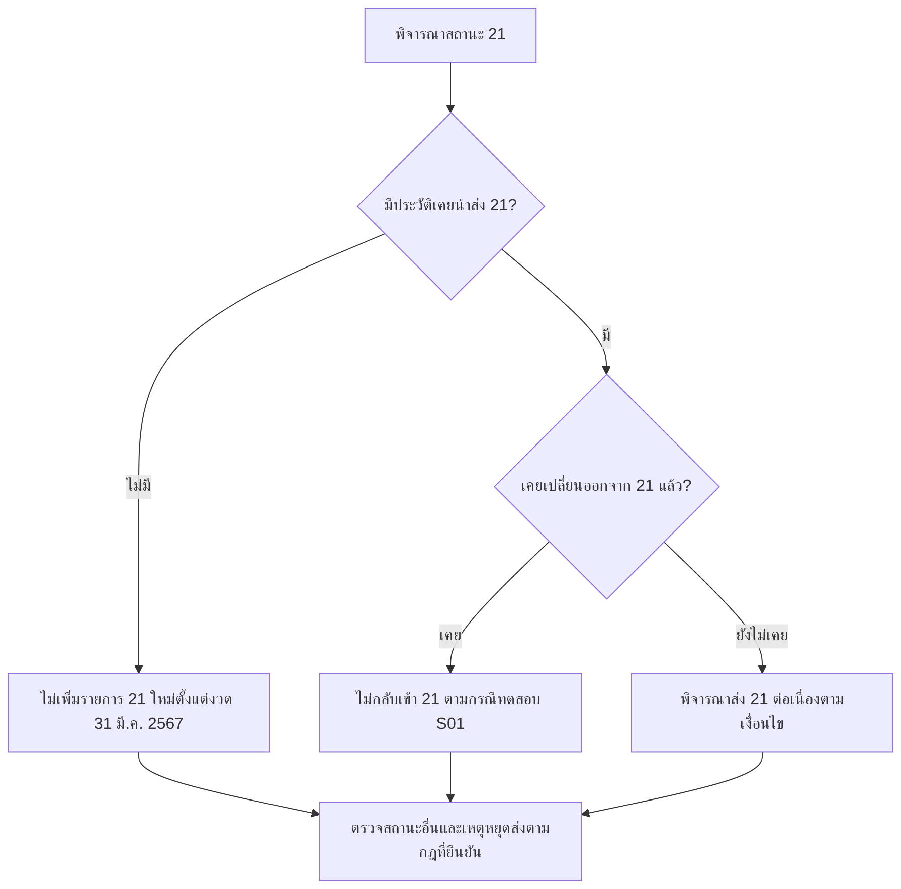
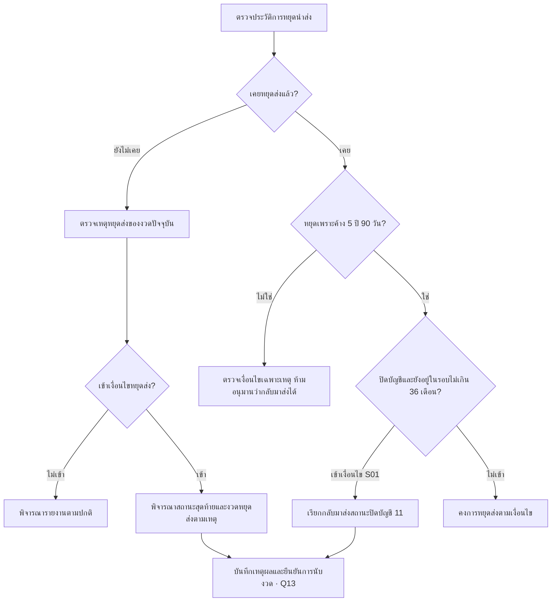

# สถานะบัญชีและเงื่อนไขหยุดนำส่ง

รหัสสถานะบัญชีกับรหัส DPD เป็นคนละชุด และ Commercial มี Catalog ID สำหรับไฟล์นำส่ง ต้องใช้ตารางให้ตรงกับรูปแบบและช่องทาง

เริ่มจาก [Flowchart ภาพรวมการนำส่ง NCB](/credit-reporting) เพื่อดูความสัมพันธ์ของธนาคาร กลุ่มภาระค้ำประกัน A–E2 และกลุ่มลูกหนี้จ่ายเคลม F ก่อนอ่านเงื่อนไขเฉพาะด้านล่าง

## สถานะที่พบในขอบเขตโครงการ

| Consumer / Commercial | Catalog ID Commercial | ความหมายและเงื่อนไขหลัก |
| --- | --- | --- |
| 10 / 010 | 1020001 | ปกติ รวมกรณีค้างชำระไม่เกิน 90 วันตามกฎ |
| 11 / 011 | 1020002 | ปิดบัญชี เช่น ชำระเสร็จหรือยกเลิก LG สถานะ 500 ตามเงื่อนไข |
| 12 / 012 | 1020003 | พักชำระหนี้ตามนโยบายสมาชิก |
| 13 / 013 | 1020049 | พักชำระหนี้ตามนโยบายรัฐ |
| 14 / 014 | 1020050 | พักชำระหนี้เกษตรกรตามนโยบายรัฐ |
| 20 / 020 | 1020004 | ค้างชำระเกิน 90 วัน |
| 21 / 021 | 1020052 | ค้างเกิน 90 วันจากสถานการณ์ไม่ปกติ ตามเงื่อนไขเฉพาะ |
| 30 / 030 | 1020005 | อยู่ในกระบวนการทางกฎหมาย |
| 31 / 031 | 1020006 | อยู่ระหว่างชำระหนี้ตามคำพิพากษาตามยอม |
| 33 / 033 | 1020008 | ปิดบัญชีเนื่องจากตัดหนี้สูญ |
| 42 / 042 | 1020011 | โอนหรือขายหนี้ที่ค้างชำระเกิน 90 วันตาม catalog |

S05 และ S01 กล่าวถึง 33/42 เพิ่มจากรายการต้นเอกสาร S11 คำอธิบาย 42 ในชุดทดสอบใช้ “ไม่เป็นสถานะบัญชีปกติ” ต้องยืนยันเงื่อนไขกับ Catalog สำหรับรูปแบบที่ใช้จริง

## สถานะ 21 ต้องพิจารณาประวัติ

ผังนี้ใช้สำหรับงวดตั้งแต่ 31 มีนาคม 2567 การกำหนดสถานะอื่นและกรณีหลายเหตุการณ์พร้อมกันยังต้องยืนยัน priority ตาม Q08

S11 ระบุเริ่มส่งงวด 31 มกราคม 2565 และไม่เพิ่มรายการใหม่ในงวด 31 มีนาคม 2567 ยกเว้นบัญชีที่เคยส่ง 21 ให้ส่งต่อจนเปลี่ยนสถานะ เมื่อเปลี่ยนออกแล้ว ชุดทดสอบระบุว่าต้องไม่กลับเข้า 21 อีก

ดังนั้นการมี DFD ในช่วงโควิดเพียงอย่างเดียวไม่เพียงพอจะสรุปผล ต้องเทียบประวัติการนำส่งด้วย หมายเหตุในไฟล์ UAT บางรายการอธิบายด้วยช่วง DFD ซึ่งยังต้องตรวจร่วมกับข้อกำหนดนี้

## คดีแพ่งและคดีล้มละลาย

| กรณี | ข้อมูลประกอบการพิจารณา |
| --- | --- |
| คดีแพ่ง สถานะ 30 | วันที่ยื่นฟ้อง เลขคดีดำ การถอนฟ้อง และวันที่ศาลอนุญาตสวมสิทธิ์ตามกรณี |
| คดีล้มละลาย สถานะ 30 | วันที่ฟ้อง/พิทักษ์ทรัพย์ การขอรับชำระหนี้ การสวมสิทธิ์ และวันถอนฟ้อง |
| สถานะ 31 | คดีแพ่ง มีคำพิพากษาชั้นต้น มี TDR Date และไม่มีการถอนฟ้องตามชุดทดสอบ |
| สถานะ 33 | ชุดทดสอบตรวจวันตัดหนี้สูญร่วมกับวันปลดล้มละลาย และระบุว่ากรณีนิติบุคคลไม่เข้าเงื่อนไขนี้ |

เอกสารบรรยายเงื่อนไขหลายชุด แต่ยังไม่ให้ decision table ที่ครอบคลุมกรณีซ้อนทั้งหมด เช่น คดีพร้อมมาตรการหรือปิดบัญชีพร้อมคดี ต้องตกลงลำดับความสำคัญก่อนนำไปเขียน CASE expression

## หยุดนำส่ง

- ค้างชำระต่อเนื่องเกิน 5 ปี 90 วัน ตามเงื่อนไขวันและงวด
- หนี้ระงับหรือชำระเสร็จ โดยต้องพิจารณารายงานสถานะปิดบัญชีก่อนหยุด
- ศาลมีคำสั่งถึงที่สุดว่าไม่มีสิทธิเรียกร้องในหนี้
- ถูกพิทักษ์ทรัพย์เด็ดขาดและสมาชิกเป็นเจ้าหนี้ไม่มีประกันที่ไม่ได้ยื่นคำขอรับชำระหนี้ตามเงื่อนไข
- โอนขายหนี้
- บุคคลธรรมดาปลดล้มละลายเกิน 2 ปีตามเงื่อนไขเอกสาร

S05 แยกกรณีครบ 5 ปี 90 วันตรงวันสิ้นเดือนให้ยังปรากฏในงวดนั้น กับกรณีเกินเกณฑ์ก่อนสิ้นเดือนที่ไม่ปรากฏ ต้องยืนยันสูตรนับปีและวัน โดยเฉพาะปีอธิกสุรทิน

## กลับมาส่งปิดบัญชีหลังหยุดส่ง

S01 ระบุกรณีเคยหยุดส่งเพราะค้าง 5 ปี 90 วัน และต่อมาปิดบัญชีขณะที่ยังอยู่ในรอบประมวลผล ให้เรียกมาส่งสถานะปิดบัญชี โดยกล่าวถึงช่วงไม่เกิน 36 เดือนนับจากหยุดส่ง กฎนี้ต้องออกแบบแยกจากการหยุดแบบถาวร เช่น โอนขายหนี้ และต้องยืนยันวิธีนับรอบกับผู้รับผิดชอบ

**แหล่งอ้างอิง:** S01, S05 และ S11 ดู [ทะเบียนเอกสาร](/sources)
