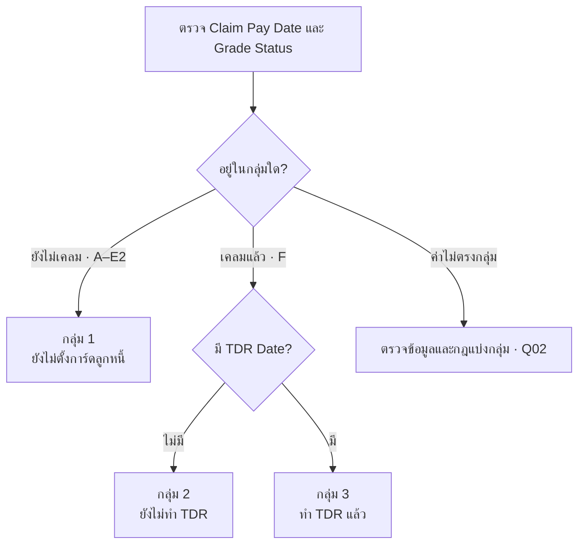
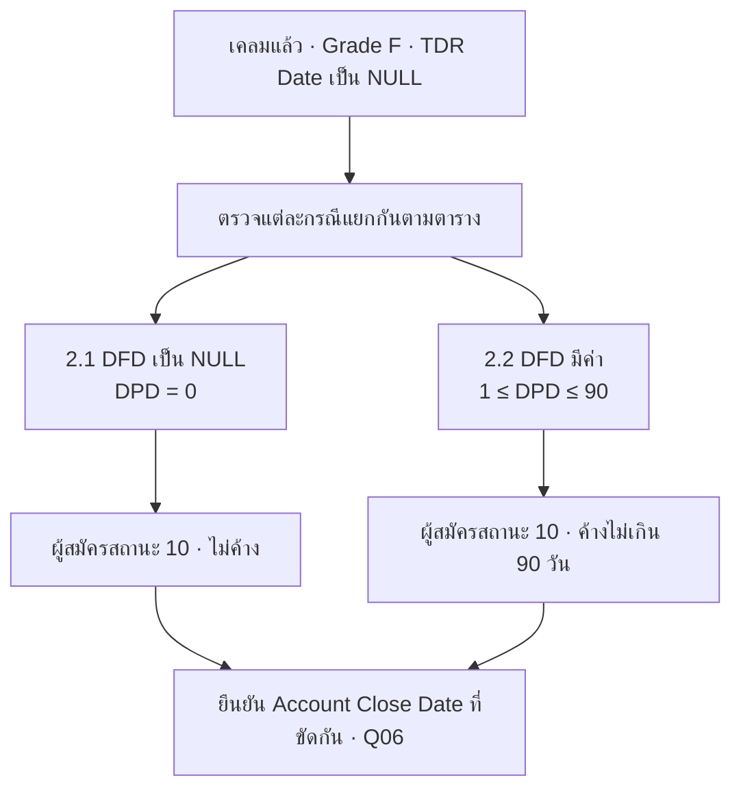
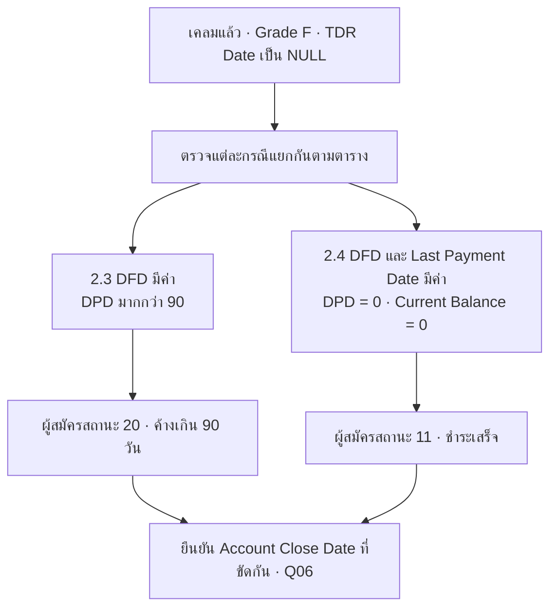
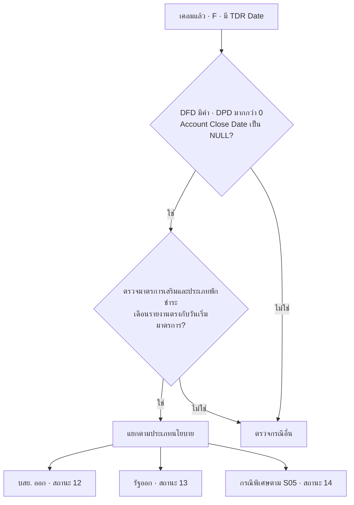
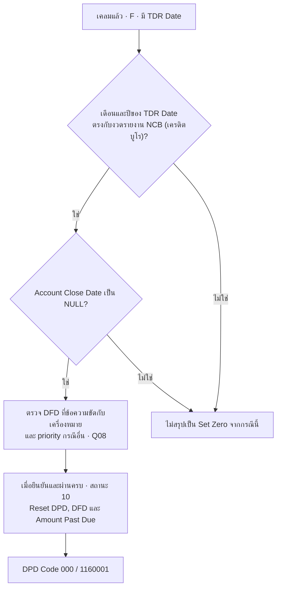
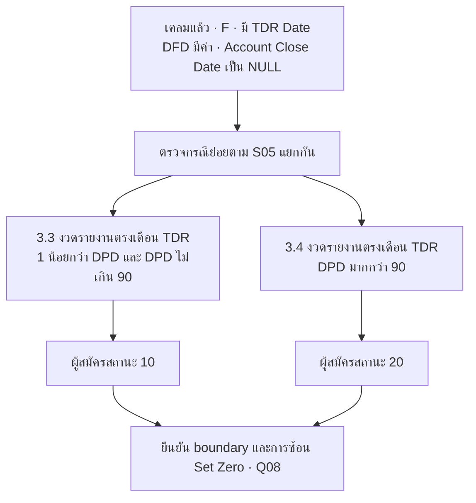
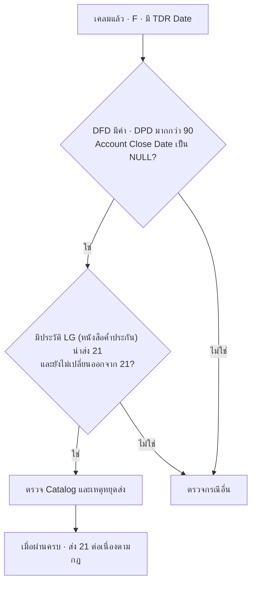
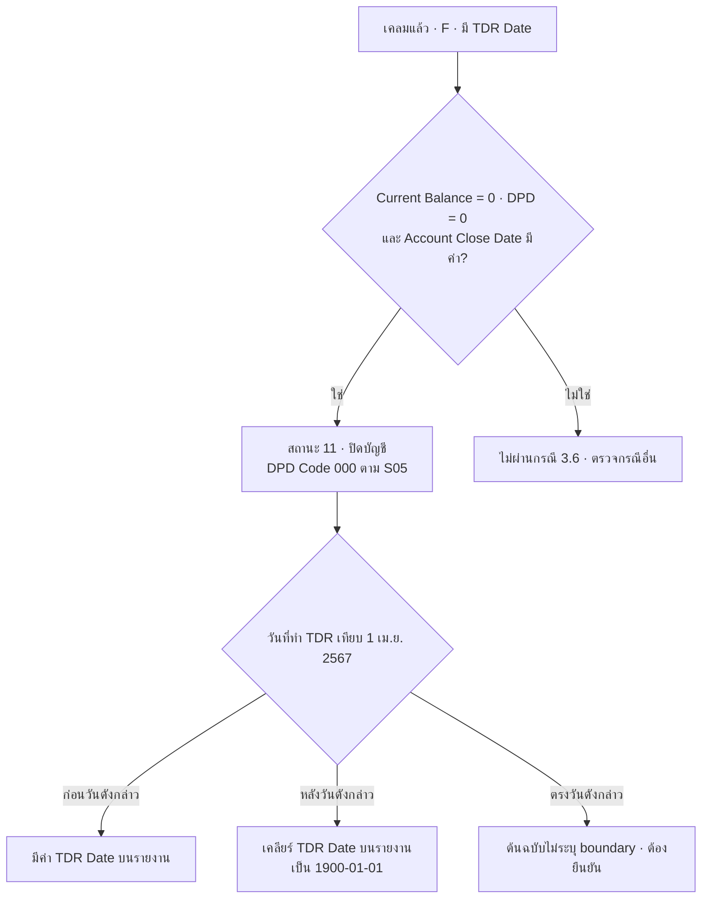
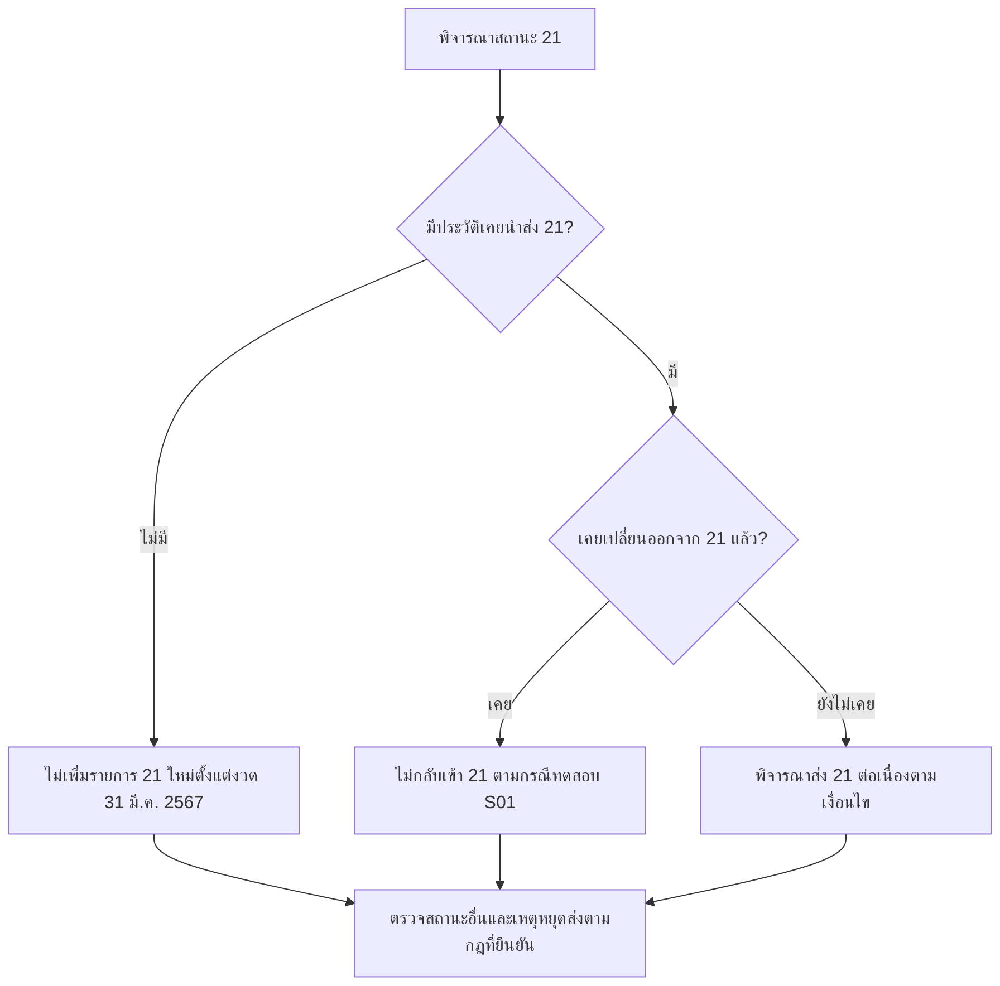
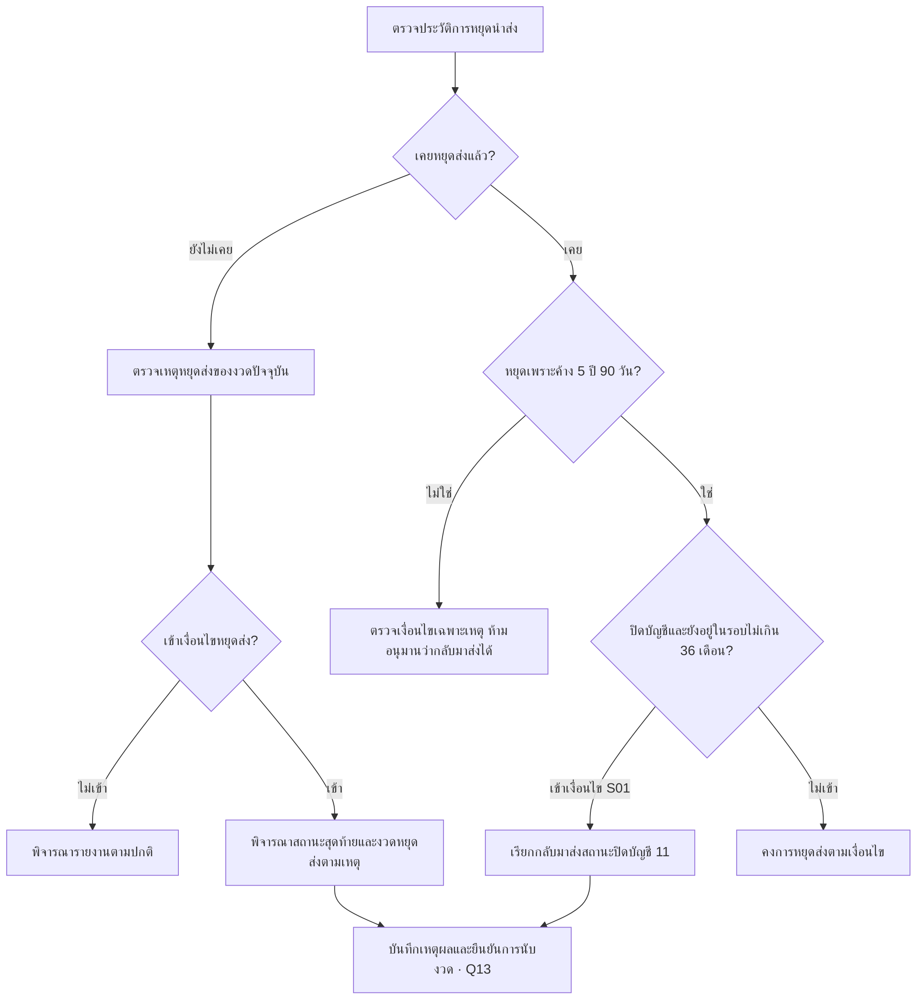

import EomGuaranteeFlow from '../components/eom-guarantee-flow'

# สถานะบัญชีและเงื่อนไขหยุดนำส่ง

บสย. ต้องเลือกกลุ่มภาระค้ำประกันหรือลูกหนี้ก่อนกำหนดสถานะที่นำส่ง NCB (เครดิตบูโร) หน้านี้จึงเริ่มจากเงื่อนไข EOM ทั้ง 3 กลุ่มและกรณีย่อย แล้วจึงรวบรหัสสถานะสำหรับตรวจเทียบ

รหัสสถานะบัญชีกับรหัส DPD เป็นคนละชุด และ Commercial มี Catalog ID สำหรับไฟล์นำส่ง ต้องใช้ตารางให้ตรงกับรูปแบบและช่องทาง

เริ่มจาก [Flowchart ภาพรวมการนำส่ง NCB (เครดิตบูโร)](/credit-reporting) เพื่อดูความสัมพันธ์ของธนาคาร กลุ่มภาระค้ำประกัน A–E2 และกลุ่มลูกหนี้จ่ายเคลม F ก่อนอ่านเงื่อนไขเฉพาะด้านล่าง

<a id="eom-account-status" />

<a id="เงื่อนไขจาก-ncb-field-data-eom-ทั้ง-3-กลุ่ม" />

## เงื่อนไข EOM สำหรับ NCB (เครดิตบูโร) ทั้ง 3 กลุ่ม

S05 ข้อ 1–3 แบ่งเงื่อนไขพื้นฐานตามการจ่ายเคลมและการทำ TDR เป็น 3 กลุ่ม รวม **13 กรณีย่อย** ในตารางด้านล่าง ตรงกับ S06 ฉบับ PDF หน้า 20–28 ส่วนข้อ 4–6 ในต้นฉบับเป็นกรณีคดีล้มละลายและคดีแพ่ง ดูส่วน [คดีแพ่งและคดีล้มละลาย](#คดีแพ่งและคดีล้มละลาย) ประกอบเมื่อมีเหตุทางคดี

| กลุ่ม | ขอบเขตตามต้นฉบับ | กรณีย่อยที่อธิบายครบด้านล่าง |
| --- | --- | --- |
| 1 | ยังไม่จ่ายเคลม เกรด A–E2 และยังไม่ตั้งการ์ดลูกหนี้ | 1.1 ปกติ 10, 1.2 ยกเลิก LG (หนังสือค้ำประกัน) สถานะ 500 ปิดบัญชี 11, 1.3 ปลดล้มละลายเกิน 2 ปี หยุดส่ง |
| 2 | จ่ายเคลม เกรด F แต่ยังไม่ทำ TDR | 2.1 ปกติไม่ค้าง 10, 2.2 ค้าง 1–90 วัน 10, 2.3 ค้างเกิน 90 วัน 20, 2.4 ชำระเสร็จ 11 |
| 3 | จ่ายเคลม เกรด F และทำ TDR | 3.1 พักชำระ 12/13/14, 3.2 Set Zero 10, 3.3 ค้างตามช่วง 10, 3.4 ค้างเกิน 90 วัน 20, 3.5 ประวัติ 21, 3.6 ปิดบัญชี 11 |

อ่านตามกลุ่ม: [กลุ่ม 1 ยังไม่เคลม](#eom-status-10-guarantee) · [กลุ่ม 2 เคลมแล้วไม่ทำ TDR](#eom-claimed-without-tdr) · [กลุ่ม 3 เคลมแล้วทำ TDR](#eom-claimed-with-tdr)

**วิธีอ่าน:** เงื่อนไขภายในแต่ละกรณีต้องผ่านร่วมกัน (AND) ส่วนกรณีย่อยเป็นคนละชุดเงื่อนไข ผังไม่ได้กำหนดให้เลือกกรณีแรกที่พบ และไม่ได้จัด priority ระหว่างคดี มาตรการ Set Zero ปิดบัญชี และหยุดส่ง หากเข้าได้หลายกรณีต้องยืนยัน [Q08](/open-questions) ก่อนกำหนดผลจริง

ชื่อฟิลด์และเครื่องหมาย `==` / `!=` คงตาม S05 เพื่อเทียบต้นฉบับ ส่วนข้อความที่ขัดกันจะระบุไว้ ณ กรณีนั้น ผลในผังคือผลที่เอกสารระบุเมื่อเงื่อนไขได้รับการยืนยันแล้ว

<a id="eom-status-10-guarantee" />

## กลุ่ม 1 ยังไม่จ่ายเคลม เกรด A–E2

อ่าน 3 กรณีของกลุ่มนี้: [ปกติ 10](#eom-normal) · [ปิดบัญชี LG (หนังสือค้ำประกัน) สถานะ 500](#eom-lg500) · [ปลดล้มละลายเกิน 2 ปี](#eom-bankruptcy)

<a id="eom-normal" />

### 1.1 สถานะปกติ 10

ถอดจาก S05 `NCB Field Data [EOM]` หัวข้อ “เงื่อนไขการกำหนดสถานะบัญชีของลูกหนี้” กรณีลูกค้าภาระค้ำประกันที่ยังไม่จ่ายเคลม เกรด A–E2 และยังไม่ตั้งการ์ดลูกหนี้ **ต้องผ่านทั้ง 7 ข้อร่วมกัน (AND)** จึงเข้าเงื่อนไขสถานะ 10 ของกรณีนี้

<EomGuaranteeFlow variant="normal" />

ผังแยกตรวจทั้ง 7 ข้อตามลำดับในต้นฉบับ ทุกข้อยังต้องผ่านร่วมกัน ไม่ใช่ priority การเลือกสถานะทุกกรณี หากไม่ผ่านข้อใด **ยังสรุปไม่ได้ว่าต้องเป็นสถานะใด หรือไม่เป็นสถานะ 10 ทุกกรณี** ต้องตรวจกลุ่มลูกค้าและกฎอื่นต่อ เช่น กรณีจ่ายเคลมแล้ว

#### รายละเอียดทั้ง 7 เงื่อนไข

| ข้อ | เงื่อนไขตามต้นฉบับ | ความหมาย / ค่าประกอบ |
| --- | --- | --- |
| 1 | Claim Pay Date == NULL | ยังไม่มีวันจ่ายค่าประกันชดเชย |
| 2 | Grade Status อยู่ใน A–E2 | อยู่ในกลุ่มภาระค้ำประกันตามนิยามกรณีนี้ |
| 3 | DFD Date == NULL | ยังไม่มีวันเริ่มผิดนัดชำระ |
| 4 | DPD น้อยกว่า 30 | ต้นฉบับระบุ Mapping Code 000 / 1160001 |
| 5 | TDR Date == NULL | ไม่มีวันทำ TDR; ต้นฉบับระบุ TDR Code 00 |
| 6 | Last Payment Date == NULL | ยังไม่มีวันที่ชำระล่าสุด |
| 7 | Account Close Date == NULL | ยังไม่มีวันปิดบัญชี |

**ขอบเขตการใช้:** เกณฑ์ DPD น้อยกว่า 30 ในผังเป็นเงื่อนไขเฉพาะกรณีนี้ตาม S05 ส่วนคำอธิบายสถานะ 10 ทั่วไปที่ค้างไม่เกิน 90 วันเป็นคนละระดับของกฎ จึงไม่เปลี่ยนเงื่อนไขในผังเป็น 90 วันเอง นอกจากนี้ Code 000 / 1160001 เป็นข้อความที่ถอดจากต้นฉบับ ต้องเทียบกับตาราง DPD โดยเฉพาะกรณีมีวันค้าง 1–29 วันก่อนใช้สร้างไฟล์จริง

`== NULL` ในตารางเป็นรูปแบบอธิบายเงื่อนไขตามเอกสาร ไม่ใช่ SQL ที่พร้อมรัน ใน SQL ต้องตรวจ NULL ด้วย `IS NULL` และต้องแยก NULL ออกจากวันที่แทนค่าว่าง เช่น `1900-01-01` ตามชั้นข้อมูล

**แหล่งอ้างอิงของผังนี้:** S05 ส่วนสถานะปกติ 10 ของลูกค้าภาระค้ำที่ยังไม่จ่ายเคลม เทียบ S06 ฉบับ PDF หน้า 20

<a id="eom-lg500" />

<a id="12-ปิดบัญชี-11-จากการยกเลิก-lg500" />

### 1.2 ปิดบัญชี 11 จากการยกเลิก LG (หนังสือค้ำประกัน) สถานะ 500

กรณีนี้ยังไม่จ่ายเคลมและเกรด A–E2 เช่นเดียวกับข้อ 1.1 แต่เพิ่ม `StatusLG == 500` (สถานะหนังสือค้ำประกัน) ใช้ DPD เท่ากับ 0 และต้องมีวันปิดบัญชี

<EomGuaranteeFlow variant="closed" />

ผังแยกครบ **8 ข้อ** โดยแสดง `StatusLG == 500` (สถานะหนังสือค้ำประกัน), DPD Code และ TDR Code ในขั้นที่เกี่ยวข้อง หากข้อใดไม่ผ่านจะไม่กำหนดสถานะ 11 จากกรณีนี้โดยอัตโนมัติ

| ข้อ | เงื่อนไขตาม S05 | ผลประกอบ |
| --- | --- | --- |
| 1 | Claim Pay Date == NULL | ยังไม่จ่ายเคลม |
| 2 | Grade Status อยู่ใน A–E2 | กลุ่มภาระค้ำ |
| 3 | StatusLG (สถานะหนังสือค้ำประกัน) == 500 | ยกเลิก LG (หนังสือค้ำประกัน) |
| 4 | DFD Date == NULL | ไม่มีวันผิดนัด |
| 5 | DPD == 0 | DPD Code 000 / 1160001 |
| 6 | TDR Date == NULL | TDR Code 00 |
| 7 | Last Payment Date == NULL | ไม่มีวันชำระล่าสุด |
| 8 | Account Close Date != NULL | มีวันปิดบัญชี |

<a id="eom-bankruptcy" />

### 1.3 ปลดล้มละลายเกิน 2 ปีและยังไม่เคลม

ผลที่ S05 ระบุคือ **หยุดส่ง NCB (เครดิตบูโร)** ไม่ใช่รหัสสถานะบัญชีใหม่ กรณีนี้ไม่ได้กำหนด DPD เพิ่มเติมในรายการเงื่อนไข

<EomGuaranteeFlow variant="bankruptcy" />

**ความต่างระหว่างข้อความกับภาพต้นฉบับ:** ข้อความมี **8 รายการ** แต่ภาพผังแสดงเพียง 7 และไม่ได้แสดง Account Close Date ข้อ 8 เว็บจึงแสดงครบตามรายการข้อความ โดยทำข้อ 8 เป็นขั้นรอยืนยัน Q06 เพราะคำว่า “ไม่มีวันปิดบัญชี” ขัดกับ `!= NULL`

ข้อ 5 เป็นการเตรียมค่า Last Payment Date: มีค่าใช้วันที่จริง ไม่มีค่าใช้ `1900-01-01` แล้วตรวจต่อได้ทั้งสองกรณี ไม่ใช่เงื่อนไขที่บังคับว่าต้องมีวันที่ชำระล่าสุด จึงใช้กล่องขั้นตอนในผัง ส่วนข้อ 7 ต้องยืนยันวิธีนับงวดและวันครบ 2 ปีตาม Q13 ก่อนสรุปผลหยุดส่ง

| ข้อ | เงื่อนไข / การเตรียมค่าตาม S05 | คำอธิบาย |
| --- | --- | --- |
| 1 | Claim Pay Date == NULL | ยังไม่จ่ายเคลม |
| 2 | Grade Status อยู่ใน A–E2 | กลุ่มภาระค้ำ |
| 3 | DFD Date == NULL | ไม่มีวันผิดนัด |
| 4 | TDR Date == NULL | TDR Code 00 |
| 5 | Last Payment Date มีค่าให้ใช้ค่านั้น ถ้าไม่มีใช้ 1900-01-01 | เป็นการเตรียมค่า ไม่ได้บังคับว่าต้องมีการชำระ |
| 6 | Bankruptcy Date != NULL | ต้นฉบับเรียกว่า “วันปลดล้มละลาย” |
| 7 | เดือนรายงานปัจจุบัน > Bankruptcy Date = 2 ปี | คงข้อความต้นฉบับ ต้องยืนยันสูตรและวันครบ 2 ปีตาม Q13 |
| 8 | “ไม่มีวันปิดบัญชี” แต่กำกับ Account Close Date != NULL | ข้อความกับเครื่องหมายขัดกัน ต้องยืนยัน Q06 |

### จุดตรวจร่วมของกลุ่ม 1

ครบ 2 ปีพอดียังไม่ควรถูกสรุปว่า “เกิน 2 ปี” โดยอัตโนมัติ ต้องยืนยันว่าจะเปรียบเทียบวันที่จริง วันสิ้นเดือน หรือเดือนรายงาน ส่วน `Bankruptcy Date` ในกรณีนี้หมายถึงวันปลดล้มละลายตามข้อความ S05 ต้องเทียบฟิลด์ต้นทางก่อนใช้จริง

<a id="eom-claimed-without-tdr" />

## กลุ่ม 2 จ่ายเคลมแต่ยังไม่ทำ TDR

เงื่อนไขร่วมทั้ง 4 กรณีคือ **Claim Pay Date != NULL, Grade Status == F และ TDR Date == NULL** โดย TDR Code เป็น 00 จากนั้นตรวจ DFD, DPD และข้อมูลปิดบัญชีของแต่ละกรณี

คำว่า “ผู้สมัครสถานะ” หมายถึงผลตามกรณีที่ S05 บรรยายไว้ โดยยังต้องผ่านเงื่อนไขครบและแก้ข้อขัดกันก่อนสรุปสถานะจริง หากไม่ผ่านเงื่อนไขร่วมด้านบน ให้ตรวจกลุ่มอื่น หากไม่ผ่านกรณีย่อยใด ให้ตรวจกรณีอื่นรวมถึงเงื่อนไขคดี

| กรณี | DFD Date | DPD และ Mapping ตามต้นฉบับ | Last Payment Date | Current Balance | Account Close Date ตามต้นฉบับ | ผลที่ระบุ |
| --- | --- | --- | --- | --- | --- | --- |
| 2.1 | == NULL | DPD == 0; Code 000 / 116001 | มีค่าใช้ค่านั้น ไม่มีกำหนด 1900-01-01 | ไม่ระบุเพิ่ม | “ไม่มีวันปิดบัญชี” แต่ != NULL | 10 ไม่ค้าง |
| 2.2 | != NULL | 1 ≤ DPD ≤ 90; Mapping ตามตาราง DPD | มีค่าใช้ค่านั้น ไม่มีกำหนด 1900-01-01 | ไม่ระบุเพิ่ม | “ไม่มีวันปิดบัญชี” แต่ != NULL | 10 ค้าง 1–90 วัน |
| 2.3 | != NULL | DPD > 90; Mapping ตามตาราง DPD | มีค่าใช้ค่านั้น ไม่มีกำหนด 1900-01-01 | ไม่ระบุเพิ่ม | “ไม่มีวันปิดบัญชี” แต่ != NULL | 20 |
| 2.4 | != NULL | DPD == 0; Code 000 / 116001 | != NULL | == 0 | “มีวันปิดบัญชี” แต่ == NULL | 11 ชำระเสร็จ |

**ข้อขัดกันที่ต้องยืนยัน:** ทั้ง 4 กรณีมีคำบรรยายวันปิดบัญชีสวนทางกับเครื่องหมาย NULL ตาม [Q06](/open-questions) ส่วนรหัส `116001` ในกลุ่มนี้มีจำนวนหลักต่างจาก `1160001` ที่ใช้ในข้อ 1.1 และกรณี Set Zero จึงเก็บตามต้นฉบับและต้องตรวจ Catalog ก่อนนำส่ง

<a id="eom-claimed-with-tdr" />

## กลุ่ม 3 จ่ายเคลมและทำ TDR

เงื่อนไขร่วมทั้ง 6 กรณีคือ **Claim Pay Date != NULL, Grade Status == F และ TDR Date != NULL** โดย S05 ระบุ TDR Code เป็น **00 หรือ 02** ต้องใช้กฎ Mapping TDR ประกอบ ไม่ใช่กำหนดเป็น 02 ทุกกรณี

### 3.1 พักชำระตามนโยบาย 12 / 13 / 14

| รายการ | รายละเอียดตาม S05 |
| --- | --- |
| DFD / ปิดบัญชี | DFD Date != NULL และ Account Close Date == NULL |
| มาตรการ | ตรวจว่ามาตรการเสริมหรือไม่ และประเภทพักชำระหนี้; เดือนรายงานตรงกับวันเริ่มมาตรการ |
| ผลตามประเภท | บสย. ออก = 12, รัฐออก = 13, กรณีพิเศษ = 14 |
| DPD | DPD > 0; Mapping ตามตาราง DPD และค้างค่านี้ไว้ |
| Last Payment Date | มีค่าใช้ค่านั้น ไม่มีใช้ 1900-01-01 |

S05 ใช้คำว่า “กรณีพิเศษ” สำหรับ 14 ขณะที่ตารางสถานะอธิบายว่าเกษตรกรตามนโยบายรัฐ ต้องยืนยันประเภทมาตรการที่เข้าเงื่อนไขจริง และวิธีคงค่า/สิ้นสุดมาตรการตาม [กฎ DFD DPD และ TDR](/business-rules)

### 3.2 สถานะ 10 แบบ Set Zero ในเดือน TDR

S05 ระบุ “ไม่มีวันผิดนัดชำระ” แต่กำกับ `DFD Date != NULL` จึงยังสรุปเงื่อนไข DFD ที่แน่นอนไม่ได้ การ Reset เป็นผลที่เอกสารกำหนดหลังเข้าเงื่อนไข ไม่ใช่เหตุให้ละเว้นการตรวจข้อมูลก่อนหน้า กรณีนี้ใช้ Last Payment Date ตามจริง หรือ `1900-01-01` เมื่อไม่มี

### 3.3 สถานะ 10 ตามช่วงค้าง และ 3.4 สถานะ 20

| กรณี | เงื่อนไขเพิ่มเติมจากเงื่อนไขร่วมกลุ่ม 3 | ค่ารายงาน |
| --- | --- | --- |
| 3.3 | DFD Date != NULL; TDR Date ตรงเดือนรายงาน; 1 < DPD ≤ 90; Account Close Date == NULL | สถานะ 10; DPD Code ตามตาราง |
| 3.4 | DFD Date != NULL; TDR Date ตรงเดือนรายงาน; DPD > 90; Account Close Date == NULL | สถานะ 20; DPD Code ตามตาราง |

ทั้งสองกรณีใช้ Last Payment Date ตามจริง หรือ `1900-01-01` เมื่อไม่มี ต้นฉบับข้อ 3.3 เขียน “ตั้งแต่ 1 ไม่ถึง 90 วัน” แต่สูตรเป็น `1 < DPD <= 90` ทำให้ขอบเขตวันที่ 1 และ 90 ไม่ตรงกับคำบรรยาย จึงคงสูตรต้นฉบับไว้ให้ตรวจสอบ นอกจากนี้ข้อ 3.2–3.4 ต่างระบุ TDR ตรงเดือนรายงาน จึงต้องยืนยันเงื่อนไขแยก Set Zero ออกจากกรณียังค้าง รวมถึงกฎหลังเดือน TDR ซึ่งรายการนี้ไม่ได้ระบุไว้

### 3.5 สถานะ 21 จากประวัติเดิม

S05 ให้ดูรายงานล่าสุดของ LG (หนังสือค้ำประกัน) ว่าเป็น `Account Status == 21 / 1020004` และใช้ Last Payment Date ตามจริง หรือ `1900-01-01` เมื่อไม่มี แต่ Catalog ID `1020004` ขัดกับรหัส 21 ใน S11 (`1020052`) ตาม Q10 ต้องใช้กฎประวัติและวันที่เริ่มห้ามเพิ่มรายการใหม่ในหัวข้อสถานะ 21 ด้านล่างประกอบ เอกสารระบุเหตุหยุดส่งของกรณีนี้ว่า ปิดบัญชี / ผิดนัด 5 ปี 90 วัน / ปลดล้มละลายเกิน 2 ปี โดยต้องตรวจงวดสุดท้ายและวิธีนับตาม Q13

### 3.6 ปิดบัญชี 11 หลังทำ TDR

| รายการ | รายละเอียดตาม S05 |
| --- | --- |
| ยอดคงเหลือ | Current Balance == 0 |
| วันทำ TDR | มี TDR Date; ก่อน 1/4/2567 มีค่าในรายงาน หลัง 1/4/2567 เคลียร์เป็น 1900-01-01 |
| DPD | DPD == 0 และ DPD Code 000; กรณีนี้ไม่ได้ระบุ Commercial Code เพิ่ม |
| Last Payment Date | มีค่าใช้ค่านั้น ไม่มีใช้ 1900-01-01 |
| วันปิดบัญชี | Account Close Date != NULL |

ต้นฉบับกรณี 3.6 ไม่ได้เพิ่มเงื่อนไข DFD จึงไม่ยกเงื่อนไขจากกรณีอื่นมาบังคับ ส่วนการเคลียร์ TDR Date เป็นค่าบนรายงาน ต้องแยกจากค่าต้นทางที่ใช้ตรวจว่าลูกหนี้เคยทำ TDR และยืนยันกรณีทำ TDR ตรงวันที่ 1 เมษายน 2567 ตาม Q07

### ข้อขัดกันของ S05 ที่ต้องยืนยันก่อนใช้กฎจริง

| ประเด็น | กรณีที่กระทบ | การตรวจต่อ |
| --- | --- | --- |
| คำว่าไม่มี/มีวันปิดบัญชีขัดกับ NULL | 1.3 และ 2.1–2.4 | Q06: ยืนยันความหมาย NULL, วันที่จริง และ sentinel |
| “ไม่มี DFD” แต่ != NULL | 3.2 | Q20: ยืนยัน DFD ก่อน Set Zero และค่าหลัง Reset |
| ช่วง DPD ไม่ตรงคำบรรยาย และ Code ต่างจำนวนหลัก | 1.1, 2.1, 2.4, 3.3 | Q19: ยืนยัน boundary และ Catalog ที่ใช้จริง |
| Set Zero กับกรณีค้างต่างอยู่ในเดือน TDR | 3.2–3.4 | Q08: ยืนยันเงื่อนไขแยกและ priority |
| รหัส 21 / 1020004 ขัด Catalog S11 | 3.5 | Q10: ยืนยัน Catalog ID |
| วันครบ 2 ปี และ TDR ตรง 1/4/2567 | 1.3 และ 3.6 | Q13 / Q07: ยืนยันสูตรและ boundary |

**แหล่งอ้างอิงของทั้ง 3 กลุ่ม:** S05 `NCB Field Data [EOM].docx` หัวข้อ “เงื่อนไขการกำหนดสถานะบัญชีของลูกหนี้” เทียบ S06 ฉบับ PDF; ประเด็นที่ยังไม่ได้ข้อยุติเก็บไว้ใน [ประเด็นที่ต้องยืนยัน](/open-questions)

## สถานะ 21 ต้องพิจารณาประวัติ

ผังนี้ใช้สำหรับงวดตั้งแต่ 31 มีนาคม 2567 การกำหนดสถานะอื่นและกรณีหลายเหตุการณ์พร้อมกันยังต้องยืนยัน priority ตาม Q08

S11 ระบุเริ่มส่งงวด 31 มกราคม 2565 และไม่เพิ่มรายการใหม่ในงวด 31 มีนาคม 2567 ยกเว้นบัญชีที่เคยส่ง 21 ให้ส่งต่อจนเปลี่ยนสถานะ เมื่อเปลี่ยนออกแล้ว ชุดทดสอบระบุว่าต้องไม่กลับเข้า 21 อีก

ดังนั้นการมี DFD ในช่วงโควิดเพียงอย่างเดียวไม่เพียงพอจะสรุปผล ต้องเทียบประวัติการนำส่งด้วย หมายเหตุในไฟล์ UAT บางรายการอธิบายด้วยช่วง DFD ซึ่งยังต้องตรวจร่วมกับข้อกำหนดนี้

## คดีแพ่งและคดีล้มละลาย

| กรณี | ข้อมูลประกอบการพิจารณา |
| --- | --- |
| คดีแพ่ง สถานะ 30 | วันที่ยื่นฟ้อง เลขคดีดำ การถอนฟ้อง และวันที่ศาลอนุญาตสวมสิทธิ์ตามกรณี |
| คดีล้มละลาย สถานะ 30 | วันที่ฟ้อง/พิทักษ์ทรัพย์ การขอรับชำระหนี้ การสวมสิทธิ์ และวันถอนฟ้อง |
| สถานะ 31 | คดีแพ่ง มีคำพิพากษาชั้นต้น มี TDR Date และไม่มีการถอนฟ้องตามชุดทดสอบ |
| สถานะ 33 | ชุดทดสอบตรวจวันตัดหนี้สูญร่วมกับวันปลดล้มละลาย และระบุว่ากรณีนิติบุคคลไม่เข้าเงื่อนไขนี้ |

เอกสารบรรยายเงื่อนไขหลายชุด แต่ยังไม่ให้ decision table ที่ครอบคลุมกรณีซ้อนทั้งหมด เช่น คดีพร้อมมาตรการหรือปิดบัญชีพร้อมคดี ต้องตกลงลำดับความสำคัญก่อนนำไปเขียน CASE expression

## สถานะที่พบในขอบเขตโครงการ

| Consumer / Commercial | Catalog ID Commercial | ความหมายและเงื่อนไขหลัก |
| --- | --- | --- |
| 10 / 010 | 1020001 | ปกติ รวมกรณีค้างชำระไม่เกิน 90 วันตามกฎ |
| 11 / 011 | 1020002 | ปิดบัญชี เช่น ชำระเสร็จหรือยกเลิก LG (หนังสือค้ำประกัน) สถานะ 500 ตามเงื่อนไข |
| 12 / 012 | 1020003 | พักชำระหนี้ตามนโยบายสมาชิก |
| 13 / 013 | 1020049 | พักชำระหนี้ตามนโยบายรัฐ |
| 14 / 014 | 1020050 | พักชำระหนี้เกษตรกรตามนโยบายรัฐ |
| 20 / 020 | 1020004 | ค้างชำระเกิน 90 วัน |
| 21 / 021 | 1020052 | ค้างเกิน 90 วันจากสถานการณ์ไม่ปกติ ตามเงื่อนไขเฉพาะ |
| 30 / 030 | 1020005 | อยู่ในกระบวนการทางกฎหมาย |
| 31 / 031 | 1020006 | อยู่ระหว่างชำระหนี้ตามคำพิพากษาตามยอม |
| 33 / 033 | 1020008 | ปิดบัญชีเนื่องจากตัดหนี้สูญ |
| 42 / 042 | 1020011 | โอนหรือขายหนี้ที่ค้างชำระเกิน 90 วันตาม catalog |

S05 และ S01 กล่าวถึง 33/42 เพิ่มจากรายการต้นเอกสาร S11 คำอธิบาย 42 ในชุดทดสอบใช้ “ไม่เป็นสถานะบัญชีปกติ” ต้องยืนยันเงื่อนไขกับ Catalog สำหรับรูปแบบที่ใช้จริง

## หยุดนำส่ง

- ค้างชำระต่อเนื่องเกิน 5 ปี 90 วัน ตามเงื่อนไขวันและงวด
- หนี้ระงับหรือชำระเสร็จ โดยต้องพิจารณารายงานสถานะปิดบัญชีก่อนหยุด
- ศาลมีคำสั่งถึงที่สุดว่าไม่มีสิทธิเรียกร้องในหนี้
- ถูกพิทักษ์ทรัพย์เด็ดขาดและสมาชิกเป็นเจ้าหนี้ไม่มีประกันที่ไม่ได้ยื่นคำขอรับชำระหนี้ตามเงื่อนไข
- โอนขายหนี้
- บุคคลธรรมดาปลดล้มละลายเกิน 2 ปีตามเงื่อนไขเอกสาร

S05 แยกกรณีครบ 5 ปี 90 วันตรงวันสิ้นเดือนให้ยังปรากฏในงวดนั้น กับกรณีเกินเกณฑ์ก่อนสิ้นเดือนที่ไม่ปรากฏ ต้องยืนยันสูตรนับปีและวัน โดยเฉพาะปีอธิกสุรทิน

## กลับมาส่งปิดบัญชีหลังหยุดส่ง

S01 ระบุกรณีเคยหยุดส่งเพราะค้าง 5 ปี 90 วัน และต่อมาปิดบัญชีขณะที่ยังอยู่ในรอบประมวลผล ให้เรียกมาส่งสถานะปิดบัญชี โดยกล่าวถึงช่วงไม่เกิน 36 เดือนนับจากหยุดส่ง กฎนี้ต้องออกแบบแยกจากการหยุดแบบถาวร เช่น โอนขายหนี้ และต้องยืนยันวิธีนับรอบกับผู้รับผิดชอบ

**แหล่งอ้างอิง:** S01, S05 และ S11 ดู [ทะเบียนเอกสาร](/sources)
