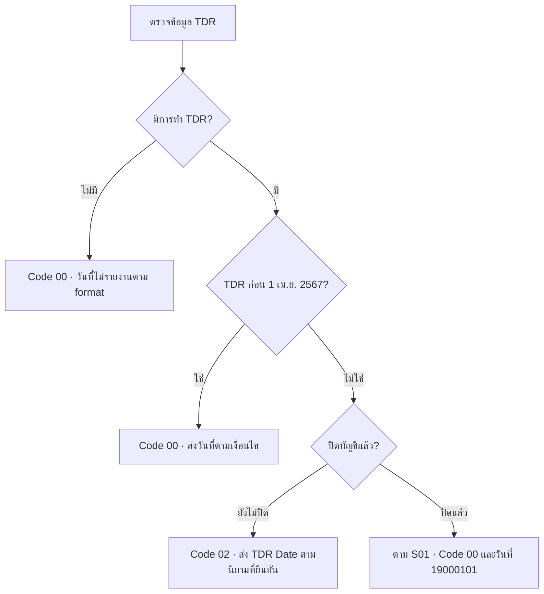
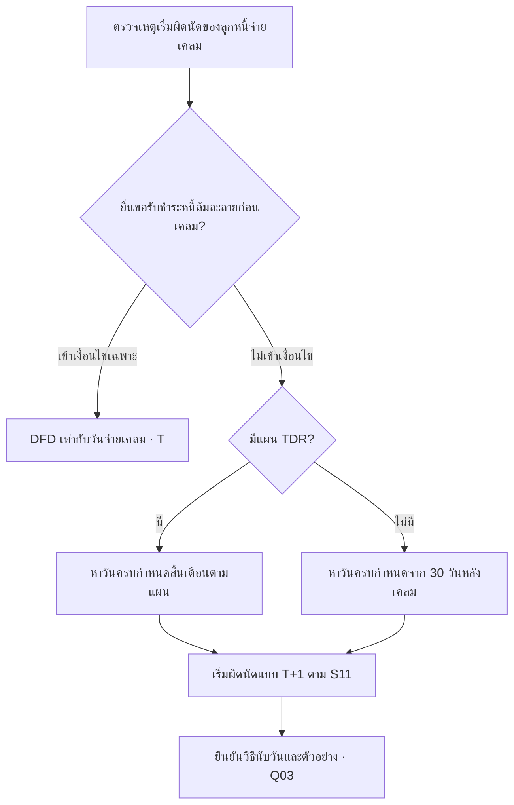
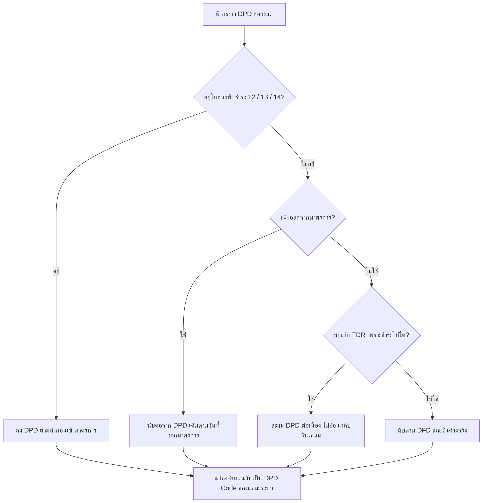
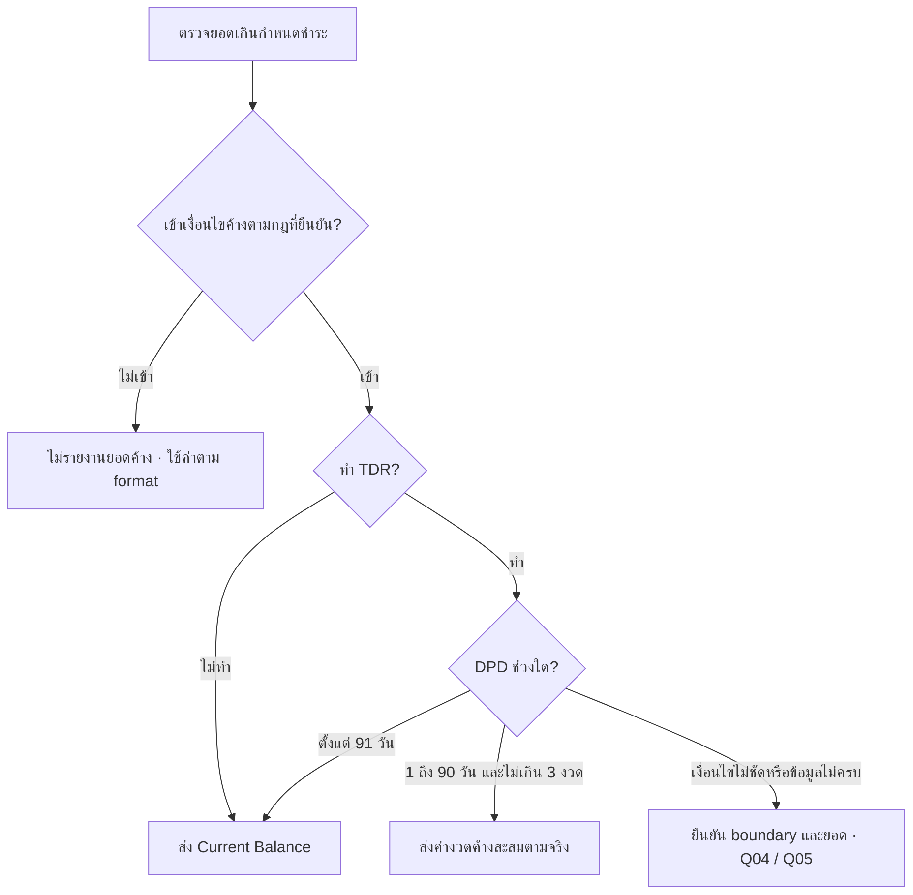

# กฎ DFD DPD และ TDR

บสย. ใช้กฎในหน้านี้คำนวณข้อมูลหนี้ที่เตรียมนำส่ง NCB (เครดิตบูโร) หลังเลือกกลุ่มบัญชีแล้ว อ่าน TDR และ Set Zero ก่อน DFD, DPD และยอดค้าง เพราะเหตุการณ์ปรับโครงสร้างหนี้มีผลต่อค่าที่ต้องรายงาน โดยตรวจแหล่ง EOM หรือ DWH ให้ตรงกับชุดที่ใช้งาน

หน้านี้สรุปกฎตาม S05 และ S11 พร้อมระบุจุดที่ตัวอย่างหรือเงื่อนไขในเอกสารไม่ตรงกัน กฎที่มีข้อขัดแย้งยังไม่ควรถูกใช้เป็น acceptance criteria จนกว่าจะยืนยัน

## TDR Date และ TDR Code

ผังนี้สรุปการเลือก Code ตามเอกสาร ต้องยืนยันนิยาม TDR Date และวันมีผลตาม Q07 ก่อนใช้คำนวณจริง

| กรณีตามเอกสาร | TDR Code | วันที่ |
| --- | --- | --- |
| ไม่ทำ TDR | 00 | ใช้ค่าไม่รายงานตาม format |
| ทำ TDR ก่อน 1 เมษายน 2567 | 00 | ส่ง TDR Date ตามเงื่อนไข |
| ทำ TDR ตั้งแต่ 1 เมษายน 2567 | 02 | ส่ง TDR Date ตามจริงตามนิยามที่ตกลง |
| ปิดบัญชีหลังทำ TDR ตั้งแต่ 1 เมษายน 2567 | ตามกรณีทดสอบให้กลับเป็น 00 | เคลียร์ TDR Date เป็น 19000101 |

S11 แยกนิยามวัน TDR ของระบบเดิมกับ DCS เฟส 2 โดยของใหม่อิงเดือนเข้าแผนปีที่ 1 เดือนที่ 1 และไม่รวมงวด Upfront ขณะที่ Mapping ระบุวัน TDR ล่าสุด ต้องยืนยันว่าวันที่แต่ละชนิดใช้ในขั้นใด

## Set Zero ในเดือนทำ TDR

เมื่อ TDR อยู่ในงวดที่นำส่ง เอกสารระบุให้เคลียร์ประวัติค้างชำระ ได้แก่ DFD, DPD และ Amount Past Due และปรับ Account Status ตามเงื่อนไข

การ reset ต้องพิจารณาร่วมกับคดีและมาตรการ เอกสารยังไม่กำหนดลำดับกรณีที่เข้าเงื่อนไขหลายข้อพร้อมกันอย่างครบถ้วน

## วันเริ่มผิดนัด DFD

| กรณี | หลักการใน S11 |
| --- | --- |
| จ่ายเคลมและยังไม่ทำ TDR | วันครบกำหนดจาก 30 วันนับจากจ่ายเคลม แล้วเริ่มผิดนัดแบบ T+1 |
| มีแผน TDR | วันครบกำหนดชำระสิ้นเดือนตามแผน แล้วเริ่มผิดนัดแบบ T+1 |
| ยื่นขอรับชำระหนี้คดีล้มละลายก่อนเคลม แล้วจ่ายเคลมภายหลัง | DFD = T คือวันจ่ายเคลม |

**ต้องยืนยันการนับวัน:** ตัวอย่างใน S05 บางข้อแสดงวันสิ้นเดือนเป็น DFD ทั้งที่คำอธิบายใช้ T+1 และตัวอย่าง 30 วันหลังเคลมยังไม่ชัดเจนเรื่องนับวันแรก จึงไม่ควรคัดตัวอย่างไปสร้างสูตรโดยตรง

## จำนวนวันค้าง DPD

ใช้ผังนี้เมื่อยืนยันแล้วว่ารายการต้องรายงาน DPD; กรณี Set Zero และเหตุการณ์ซ้อนต้องยืนยันลำดับกฎตาม Q08

- กรณีปกติเริ่มนับพร้อม DFD และสะสมทุกวันที่ค้างชำระ
- เมื่อปิดหรือยกเลิกแผน TDR เพราะชำระไม่ได้ ให้นับต่อเนื่อง ไม่ย้อนกลับไปเริ่มจากวันจ่ายเคลมจนทำให้ DPD กระโดด
- ระหว่างมาตรการพักชำระสถานะ 12/13/14 ให้คงค่า DPD ตามก่อนเข้ามาตรการ และนับต่อเมื่อออกมาตรการ

ตัวอย่างจาก S05: ก่อนมาตรการมี DPD 36 วัน ระหว่างพักยังเป็น 36 และเมื่อออกมาตรการแล้ว 2 วันเป็น 38 วัน ต้องยืนยันวันเริ่มและวันสิ้นสุดมาตรการที่จะใช้จริง

## Amount Past Due

ผังยึดคำอธิบายใน S11; จุดเริ่มค้างของรายไม่ทำ TDR และ boundary 90/91 วันยังมีข้อความขัดกันตามหมายเหตุด้านล่าง

| กรณี | หลักการสรุปตาม S11 |
| --- | --- |
| ไม่ทำ TDR และเกิดการค้างตามเงื่อนไข | ส่ง Current Balance |
| ทำ TDR ค้าง 1–90 วัน ไม่เกิน 3 งวด | ส่งค่างวดค้างสะสมตามจริง |
| ทำ TDR ค้างตั้งแต่ 91 วัน | ส่ง Current Balance |

S05 มีเงื่อนไขตัวเขียนผิดบริเวณ DPD 90/91 วัน และกรณีไม่ทำ TDR ระบุทั้ง “1 วันขึ้นไป” กับ “DPD มากกว่า 30” ต้องยืนยันขอบเขตให้แน่นอน ในกฎนี้ Installment Amount หมายถึงค่างวดค้างสะสม ซึ่งอาจไม่เท่ากับค่างวดปกติหนึ่งงวด

## Mapping DPD Code

| จำนวนวัน | Consumer | Commercial แบบ By Request | Commercial แบบ Batch |
| --- | --- | --- | --- |
| ไม่ค้าง | 000 | 000 | 1160001 |
| 1–30 | 000 ตามตารางตัวอย่าง S11 | 001 | 1160002 |
| 31–60 | 001 | 002 | 1160003 |
| 61–90 | 002 | 003 | 1160004 |
| 91–120 | 003 | 004 | 1160005 |
| 121–150 | 004 | 005 | 1160006 |
| 151–180 | 005 | 006 | 1160007 |
| 181–210 | 006 | 007 | 1160008 |
| 211–240 | 007 | 008 | 1160009 |
| 241–270 | 008 | 009 | 1160010 |
| 271–300 | 009 | 010 | 1160011 |
| มากกว่า 300 | F | 011 | 1160012 |

รหัส Consumer ช่วง 1–30 วันในตาราง lookup บางตำแหน่งเว้นช่อง แต่ตาราง scenario S11 แสดง 000 จึงต้องตรวจ format ที่ใช้อ้างอิง รหัส F ต้องจัดรูปแบบตามคู่มือ TUDF ไม่ควรถือว่าข้อความ `F` เดี่ยวเป็น record พร้อมส่ง ค่า Y/N ใช้กับ Overdraft ตามคู่มือ ไม่ใช่รหัสทั่วไปของ LG (หนังสือค้ำประกัน)

## Boundary ที่ควรทดสอบ

วันก่อน/วันตรง/วันหลัง 1 เมษายน 2567, DPD 0/1/30/31/60/61/90/91/300/301, เดือนสั้นและปีอธิกสุรทิน, TDR active/inactive, เข้าและออกมาตรการกลางเดือน และกรณี TDR เกิดพร้อมคดี

**แหล่งอ้างอิง:** S01, S02, S05 และ S11 ดู [ทะเบียนเอกสาร](/sources)
