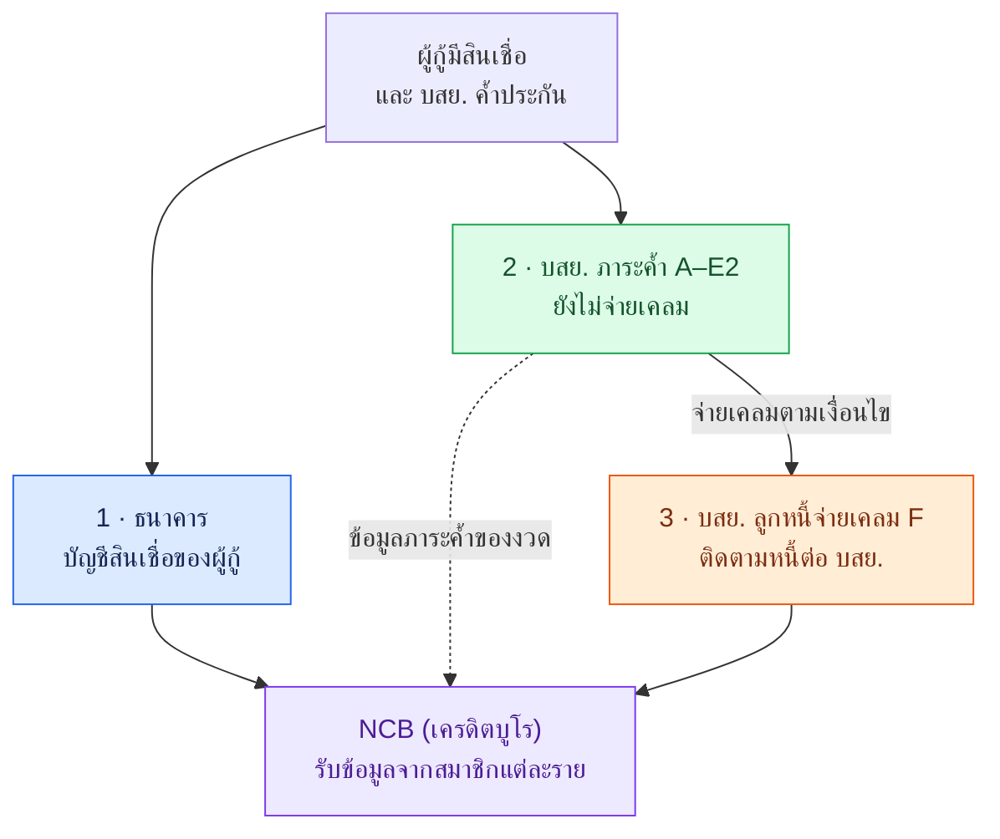
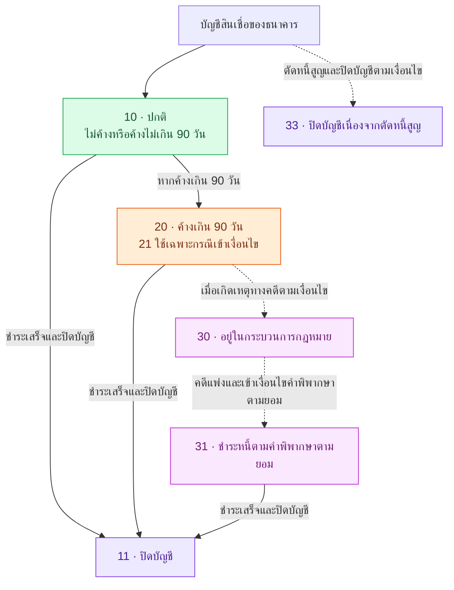
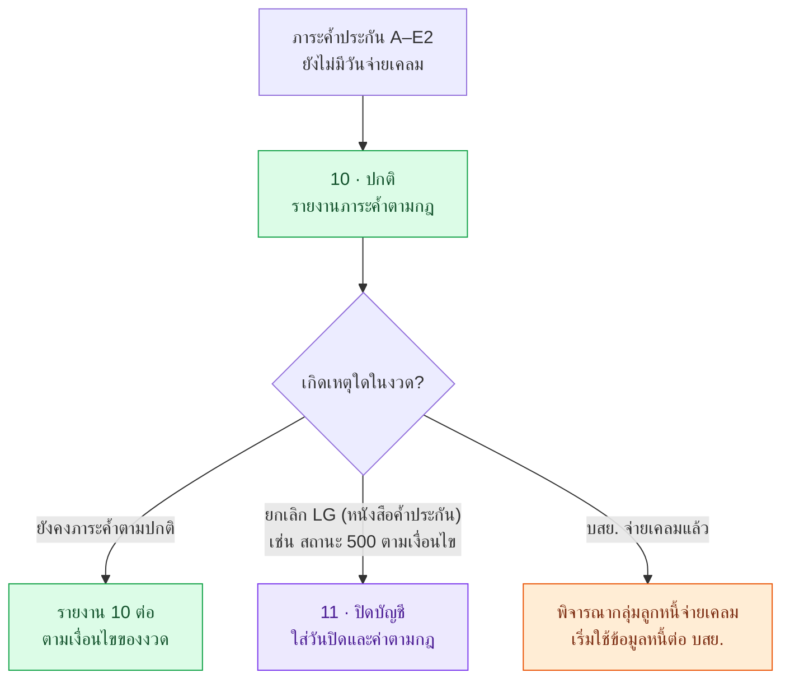
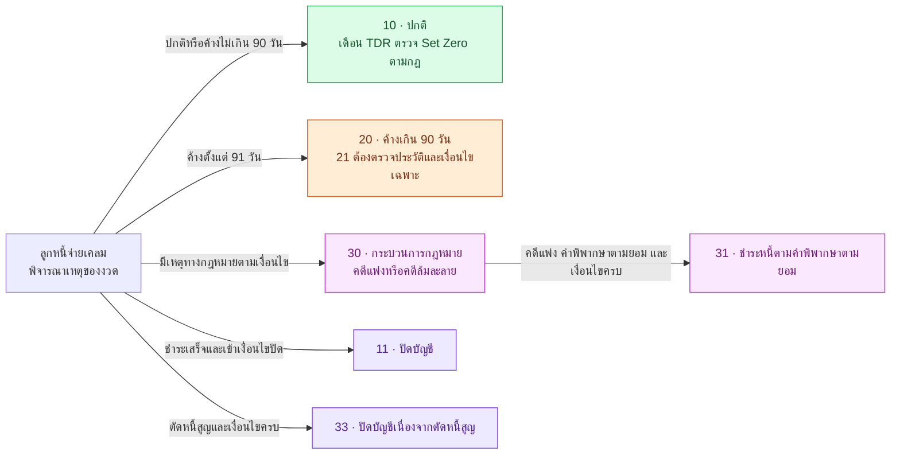

# ภาพรวมการนำส่งข้อมูลเครดิตให้ NCB (เครดิตบูโร)

หน้านี้อธิบายภาพที่ผู้ใช้ส่งมา โดยแยก **บัญชีสินเชื่อของธนาคาร**, **ภาระค้ำประกันของ บสย.** และ **ลูกหนี้หลัง บสย. จ่ายเคลม** ออกจากกัน แต่ละเส้นทางมีข้อมูลและเหตุเปลี่ยนสถานะของตนเอง

<a id="lg-คืออะไร" />

## LG (หนังสือค้ำประกัน) คืออะไร

**LG (หนังสือค้ำประกัน)** มีชื่อเต็มว่า **Letter of Guarantee** ในโครงการนี้หมายถึงหนังสือค้ำประกันสินเชื่อของ **บสย.** ที่เกี่ยวข้องกับสินเชื่อของผู้กู้กับธนาคาร โดยธนาคารเป็นผู้ให้กู้ ผู้ประกอบการเป็นผู้กู้ และ บสย. เป็นผู้ค้ำประกันตามเงื่อนไข

ตัวอย่างสมมติ: ผู้ประกอบการกู้เงินจากธนาคาร และ บสย. ออกหนังสือค้ำประกันเลข **LG-A (ตัวอย่างเลขหนังสือค้ำประกัน)** ระบบจึงใช้เลข LG-A (ตัวอย่างเลขหนังสือค้ำประกัน) อ้างอิงรายการค้ำประกันนั้น เพื่อติดตามภาระค้ำ สถานะการยกเลิก และการจ่ายค่าประกันชดเชย หากมีการจ่ายเคลมตามเงื่อนไข ก็ต้องติดตามข้อมูลลูกหนี้ต่อ บสย. เพิ่มเติม

| คำที่พบในผัง | ความหมายในโครงการ |
| --- | --- |
| เลข LG (หนังสือค้ำประกัน) / LG Number (เลขหนังสือค้ำประกัน) | เลขอ้างอิงหนังสือค้ำประกัน ซึ่ง Mapping ของโครงการใช้เป็นเลขบัญชีรายงาน |
| ภาระค้ำประกันของ LG (หนังสือค้ำประกัน) | ภาระที่ บสย. ค้ำประกันตามหนังสือและเงื่อนไขที่เกี่ยวข้อง |
| ยกเลิก LG (หนังสือค้ำประกัน) / LG (หนังสือค้ำประกัน) สถานะ 500 | ยกเลิกรายการค้ำประกัน โดย `StatusLG == 500` (สถานะหนังสือค้ำประกัน) เป็นเงื่อนไขหนึ่งของกรณีปิดบัญชีในเอกสาร EOM |
| จ่ายเคลม LG (หนังสือค้ำประกัน) | บสย. จ่ายค่าประกันชดเชยตามเงื่อนไข และเกิดข้อมูลลูกหนี้ที่ต้องติดตามต่อ |

หนังสือค้ำประกันหนึ่งฉบับอาจเกี่ยวข้องกับผู้กู้หลักและผู้กู้ร่วมหลายคน จึงมีหลักการรายงาน **LG (หนังสือค้ำประกัน) by ID** คือแยกตามเลข LG (หนังสือค้ำประกัน) และตัวตนของผู้กู้แต่ละราย ดู [ตัวอย่าง LG (หนังสือค้ำประกัน) by ID](/overview#หน่วยข้อมูล-lg-by-id) และ [เงื่อนไขปิดบัญชี LG (หนังสือค้ำประกัน) สถานะ 500](/account-status#eom-lg500)

ชื่อเต็ม LG (หนังสือค้ำประกัน) อ้างอิง [ธนาคารแห่งประเทศไทย](https://www.bot.or.th/th/news-and-media/news/news-20221028.html) ส่วนบทบาทของ LG (หนังสือค้ำประกัน) และ Mapping ในโครงการอ้างอิง S05/S11 ตาม [ทะเบียนเอกสาร](/sources)

## ความสัมพันธ์ของทั้งสามเส้นทาง

ลูกศรจากภาระค้ำไปลูกหนี้หมายถึง **เหตุการณ์จ่ายค่าประกันชดเชยจริง** ไม่ได้แปลว่าเมื่อธนาคารรายงานสถานะ 20/21 แล้ว บสย. ต้องจ่ายเคลมทันที บัญชีที่ธนาคารรายงานกับรายการที่ บสย. รายงานต้องพิจารณาแยกตามข้อเท็จจริงของแต่ละสมาชิก

ภาพรวมใช้ชื่อเกรด A–E2 และ F ตาม S05 และภาพของผู้ใช้ ส่วน S11 ระบุกลุ่มจ่ายเคลมครอบคลุม E1/E2/F ด้วย จึงยังต้องยืนยันกฎแบ่งกลุ่มกับวันจ่ายเคลมตาม Q02

## 1. เส้นทางบัญชีสินเชื่อของธนาคาร

ภาพของผู้ใช้แสดงลำดับสถานะตั้งแต่ปกติ ค้างเกิน 90 วัน เข้ากระบวนการกฎหมาย จนปิดบัญชี ผังนี้ใช้ช่วยอ่านภาพดังกล่าว **ไม่ได้ยืนยันกฎดำเนินงานของธนาคารทุกแห่ง** และไม่ได้หมายความว่าต้องผ่านทุกสถานะตามลำดับ

เส้นประเป็นเหตุการณ์ที่อาจเกิดขึ้นตามเงื่อนไข ตัวอย่างเช่น การค้างเกิน 90 วันเพียงอย่างเดียวไม่ทำให้เป็นสถานะ 30 ต้องมีเหตุทางกฎหมายประกอบ

## 2. บสย. กลุ่มภาระค้ำประกัน A–E2

กลุ่มนี้ยังไม่มีการจ่ายเคลมตามนิยาม S05 ข้อมูลที่ติดตามจึงเป็นภาระค้ำประกัน ในกรณีปกติรายงานสถานะ 10 โดยไม่รายงานยอดหนี้คงเหลือและวันค้างชำระในฐานะลูกหนี้จ่ายเคลม ใช้ค่าศูนย์หรือค่าไม่รายงานตาม format แทนการละฟิลด์ออกจากไฟล์

ผังนี้แสดงกรณีหลักตามภาพ ส่วนเหตุพิเศษ เช่น ล้มละลายหรือหยุดนำส่ง ต้องตรวจเพิ่มใน [สถานะบัญชีและเงื่อนไขหยุดนำส่ง](/account-status) การมีหนี้ค้างที่ธนาคารไม่ได้ทำให้ข้อมูลภาระค้ำของ บสย. เปลี่ยนตามธนาคารโดยอัตโนมัติ

## 3. บสย. กลุ่มลูกหนี้จ่ายเคลม F

เมื่อ บสย. จ่ายค่าประกันชดเชยตามเงื่อนไขแล้ว ระบบติดตามหนี้ต่อ บสย. โดยพิจารณาการชำระ DFD, DPD, แผน TDR และข้อมูลคดี การเลือกสถานะต้องยึดเหตุของงวดจริง

ผังนี้แยกเหตุที่ต้องพิจารณา ไม่ได้กำหนดลำดับความสำคัญระหว่างเหตุซ้อน หากมี TDR คดี หรือปิดบัญชีในงวดเดียวกัน ต้องยืนยัน priority ตาม Q08 การแยกเป็นหลายทางช่วยให้เห็นว่าอาจปิดบัญชีได้โดยไม่ต้องผ่านสถานะ 20 → 30 → 31 ทุกครั้ง

## มาตรการพักชำระและ TDR ในภาพ

| เรื่อง | คำอธิบายสำหรับอ่านภาพ |
| --- | --- |
| สถานะ 12 / 13 | ใช้ระหว่างมาตรการพักชำระตามนโยบายสมาชิก / รัฐ เมื่อเข้าเงื่อนไข ไม่ใช่ขั้นที่ลูกหนี้ทุกคนต้องผ่าน |
| สถานะ 14 | เอกสารโครงการกล่าวถึงกรณีพักชำระเกษตรกรตามนโยบายรัฐเพิ่มจากภาพ |
| DPD ระหว่างพักชำระ | คงค่าตามก่อนเข้ามาตรการ และนับต่อเมื่อออกมาตรการตามกฎที่ยืนยัน |
| TDR Set Zero | ในงวดที่เข้าเงื่อนไขทำ TDR ให้เคลียร์ DFD, DPD และ Amount Past Due และพิจารณาสถานะตามกฎ ไม่ใช่ทุกบัญชีเกรด F มี DPD เป็นศูนย์เสมอ |
| สถานะ 21 | ไม่ได้เลือกเพราะ DPD เกิน 90 วันอย่างเดียว ต้องตรวจประวัติและเงื่อนไข ห้ามเพิ่มรายใหม่ตามข้อกำหนดงวดที่ระบุ |
| สถานะ 33 | ไม่ใช่ผลอัตโนมัติของการปิดบัญชี ต้องมีเหตุและเงื่อนไขตัดหนี้สูญ; S01 ยังระบุข้อจำกัดกรณีนิติบุคคล |

อ่านผังตัดสินใจเฉพาะเรื่องได้ใน [กฎ DFD DPD และ TDR](/business-rules) และ [สถานะบัญชี](/account-status) ส่วน [ประเด็นที่ต้องยืนยัน](/open-questions) รวบรวมข้อขัดแย้งที่ยังไม่ควรสรุปแทนเจ้าของกฎ

**แหล่งอ้างอิง:** ภาพรวมที่ผู้ใช้ส่งเพิ่มเติม (U01) สำหรับการจัดเส้นทาง และ S01, S05, S11 สำหรับกฎโครงการ ดู [ทะเบียนเอกสาร](/sources) แถวธนาคารเป็นการอธิบายภาพ ไม่ใช่ข้อกำหนดเพิ่มเติมให้ระบบ DCS จัดทำรายงานแทนธนาคาร
