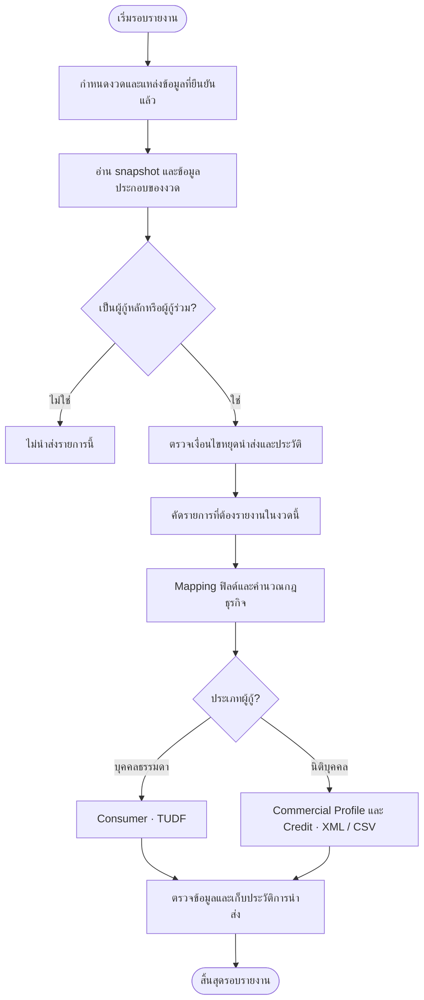
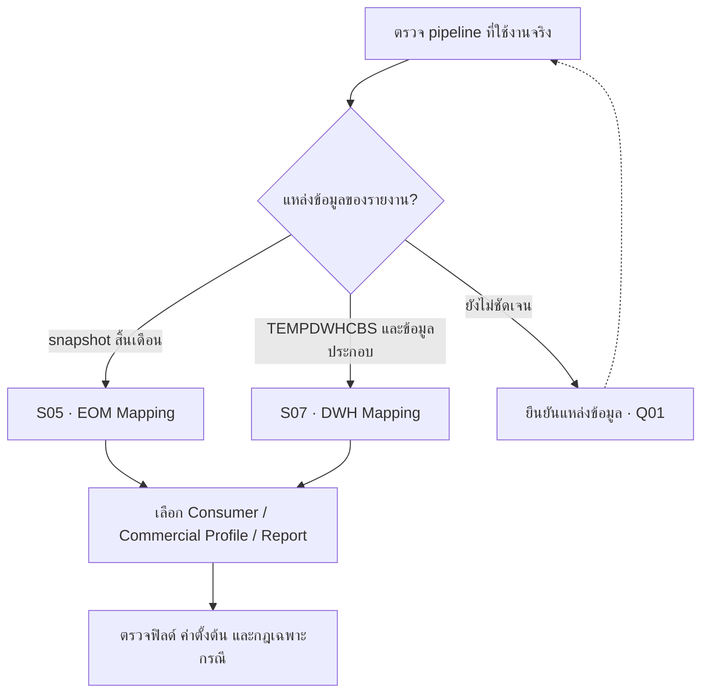

# กระบวนการและแหล่งข้อมูล

บสย. ต้องเตรียมรายงานให้ NCB (เครดิตบูโร) โดยแยกความหมายของข้อมูล EOD รายวันและ EOM สิ้นเดือนก่อนเลือกแหล่ง Mapping หน้านี้จึงเริ่มจากภาพรวมการจัดทำรายงาน แล้วจึงเปรียบเทียบแหล่งข้อมูลและรายละเอียดฟิลด์

เอกสารมี Mapping สองแนวทาง การเลือกแนวทางต้องอิง pipeline ที่ใช้งานจริง ไม่ควรนำค่าตั้งต้นจาก DWH มาใช้แทนค่าหนี้จาก EOM โดยอัตโนมัติ

หากเพิ่งเริ่มอ่าน: **บสย. คือผู้จัดทำข้อมูล, NCB (เครดิตบูโร) คือผู้รับข้อมูลเครดิต, EOD คือข้อมูลสิ้นวัน และ EOM คือข้อมูลสิ้นเดือน** อ่าน [ความหมายและตัวอย่าง](/glossary) ก่อนดูแผนภาพด้านล่างได้

## ลำดับอ่านข้อมูลที่สังเคราะห์จากเอกสาร

ลำดับข้างต้นเป็นภาพรวมเพื่ออธิบายความสัมพันธ์ ไม่ใช่ job dependency ที่ยืนยันจากซอร์สโค้ด เอกสารไม่ได้ระบุชื่อ job เวลา cutoff หรือวิธี retry อย่างครบถ้วน

## เปรียบเทียบแนวทาง Mapping

| แนวทาง | แหล่งข้อมูลหลัก | ลักษณะ |
| --- | --- | --- |
| EOM · S05 | DataEndOfMonth และ Master บางส่วน | รวมข้อมูลส่วนใหญ่ไว้ใน snapshot สิ้นเดือน |
| DWH · S07 | TEMPDWHCBS, DataLG (ตารางข้อมูลหนังสือค้ำประกัน), LTDataCaseMain และ Master | มีค่าตั้งต้นหลายรายการ เช่น ยอดหนี้ DPD และวันที่บางฟิลด์ |

### เลือกชุด Mapping ให้ตรงกับแหล่งข้อมูล

แผนภาพนี้ช่วยเลือกเอกสารอ้างอิง ไม่ได้กำหนดว่า EOD, EOM และ DWH ต้องรันต่อกันในลำดับเดียว

## ตัวอย่างความต่างที่มีผลต่อการพัฒนา

| ฟิลด์ | EOM · S05 | DWH · S07 |
| --- | --- | --- |
| customer_code | CIFNo จาก DataEndOfMonth | customercode จาก TEMPDWHCBS |
| default_date | DFDDate จาก DataEndOfMonth | default 1900-01-01 |
| amount_owned | DebtBalance จาก DataEndOfMonth | 0 |
| claim_pay_date | ClaimPayDate จาก DataEndOfMonth | default 1900-01-01 |
| date_of_restructuring | TDRDateLastest จาก DataEndOfMonth | default 1900-01-01 |

ดูชื่อสะกดและแหล่งข้อมูลครบทุกฟิลด์ใน [พจนานุกรมฟิลด์](/fields) ชื่อฟิลด์และตารางที่ไม่สอดคล้องกันต้องตรวจ schema จริง

## ขั้นตอนควบคุมที่เสนอให้มี

1. ระบุงวด snapshot และเวลา cutoff ก่อนเริ่มสร้างรายงาน
2. บันทึกแหล่งข้อมูลและรุ่นกฎที่ใช้กับแต่ละงวด
3. ตรวจจำนวน LG (หนังสือค้ำประกัน) by ID ก่อนและหลังคัดออก พร้อมเหตุผล
4. ตรวจรายการซ้ำ ฟิลด์จำเป็น และความสัมพันธ์ของวันที่กับงวดรายงาน
5. เทียบสถานะกับงวดก่อน โดยเฉพาะ 21, การพักชำระ และการหยุดนำส่ง
6. แยกขั้นสร้างข้อมูลรายงานออกจากการแปลงไฟล์นำส่ง เพื่อทดสอบแต่ละชั้นได้

รายการนี้เป็นข้อเสนอแนะด้านการออกแบบ ยังไม่ยืนยันว่าระบบมีขั้นตอนดังกล่าวแล้ว

**แหล่งอ้างอิง:** S05 และ S07 ดู [ทะเบียนเอกสาร](/sources)
