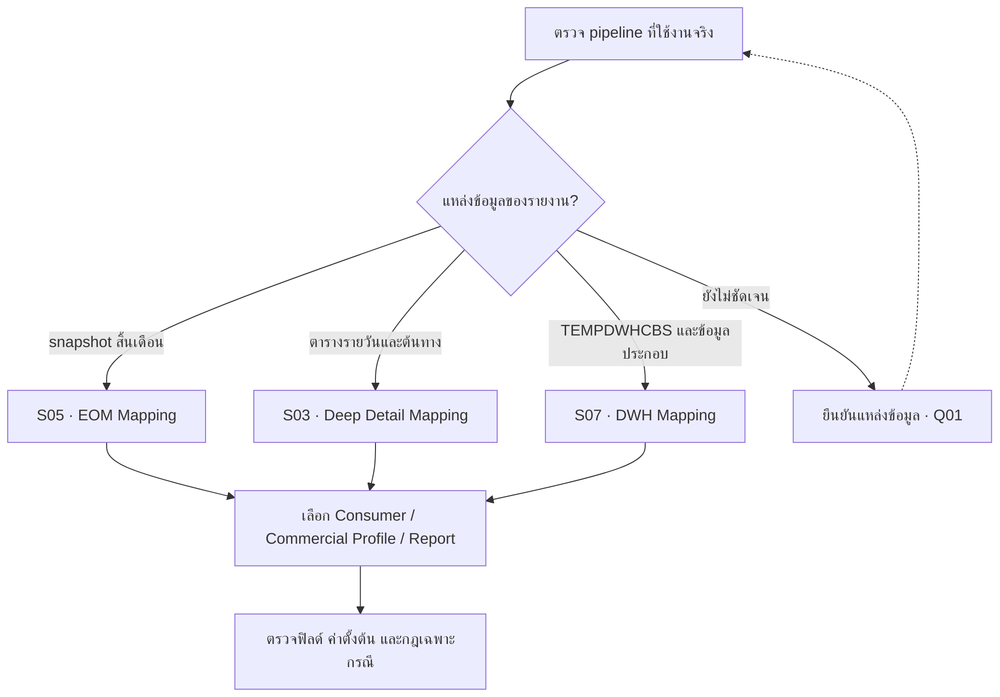

# กระบวนการและแหล่งข้อมูล

เอกสารมี Mapping สามแนวทาง การเลือกแนวทางต้องอิง pipeline ที่ใช้งานจริง ไม่ควรนำค่าตั้งต้นจาก DWH มาใช้แทนค่าหนี้จาก EOM โดยอัตโนมัติ

หากเพิ่งเริ่มอ่าน: **EOD คือข้อมูลสิ้นวัน, EOM คือข้อมูลสิ้นเดือน, บสย. คือหน่วยงานค้ำประกันสินเชื่อที่จัดทำข้อมูล และ NCB คือเครดิตบูโรผู้รับข้อมูล** อ่าน [ความหมายและตัวอย่าง](/glossary) ก่อนดูแผนภาพด้านล่างได้

## เปรียบเทียบแนวทาง Mapping

| แนวทาง | แหล่งข้อมูลหลัก | ลักษณะ |
| --- | --- | --- |
| Deep Detail · S03 | DataEndOfDay, DataDebtor, DataDebtorAddress, DataLG และตาราง TDR | กระจายข้อมูลตามตารางต้นทางและข้อมูลรายวัน |
| EOM · S05 | DataEndOfMonth และ Master บางส่วน | รวมข้อมูลส่วนใหญ่ไว้ใน snapshot สิ้นเดือน |
| DWH · S07 | TEMPDWHCBS, DataLG, LTDataCaseMain และ Master | มีค่าตั้งต้นหลายรายการ เช่น ยอดหนี้ DPD และวันที่บางฟิลด์ |

## ลำดับอ่านข้อมูลที่สังเคราะห์จากเอกสาร

ลำดับข้างต้นเป็นภาพรวมเพื่ออธิบายความสัมพันธ์ ไม่ใช่ job dependency ที่ยืนยันจากซอร์สโค้ด เอกสารไม่ได้ระบุชื่อ job เวลา cutoff หรือวิธี retry อย่างครบถ้วน

### เลือกชุด Mapping ให้ตรงกับแหล่งข้อมูล

แผนภาพนี้ช่วยเลือกเอกสารอ้างอิง ไม่ได้กำหนดว่า EOD, EOM และ DWH ต้องรันต่อกันในลำดับเดียว

## ตัวอย่างความต่างที่มีผลต่อการพัฒนา

| ฟิลด์ | Deep Detail | EOM | DWH |
| --- | --- | --- | --- |
| customer_code | CIFNo จาก DataEndOfDay | CIFNo จาก DataEndOfMonth | customercode จาก TEMPDWHCBS |
| default_date | DFD จาก DataEndOfDay | DFDDate จาก DataEndOfMonth | default 1900-01-01 |
| amount_owned | DebtBalance จาก DataEndOfDay | DebtBalance จาก DataEndOfMonth | 0 |
| claim_pay_date | ClaimDate จาก DataLG | ClaimPayDate จาก DataEndOfMonth | default 1900-01-01 |
| date_of_restructuring | TDRDate จากตารางที่ต้นฉบับเรียก TDRDateCompromiseContract | TDRDateLastest จาก DataEndOfMonth | default 1900-01-01 |

ดูชื่อสะกดและแหล่งข้อมูลครบทุกฟิลด์ใน [พจนานุกรมฟิลด์](/fields) ชื่อ `DateEndOfDay`, `DateEndOfMonth` และ `TDRDateCompromiseContract` บางจุดในต้นฉบับอาจเป็นชื่อพิมพ์คลาดเคลื่อน ต้องตรวจ schema จริง

## ขั้นตอนควบคุมที่เสนอให้มี

1. ระบุงวด snapshot และเวลา cutoff ก่อนเริ่มสร้างรายงาน
2. บันทึกแหล่งข้อมูลและรุ่นกฎที่ใช้กับแต่ละงวด
3. ตรวจจำนวน LG by ID ก่อนและหลังคัดออก พร้อมเหตุผล
4. ตรวจรายการซ้ำ ฟิลด์จำเป็น และความสัมพันธ์ของวันที่กับงวดรายงาน
5. เทียบสถานะกับงวดก่อน โดยเฉพาะ 21, การพักชำระ และการหยุดนำส่ง
6. แยกขั้นสร้างข้อมูลรายงานออกจากการแปลงไฟล์นำส่ง เพื่อทดสอบแต่ละชั้นได้

รายการนี้เป็นข้อเสนอแนะด้านการออกแบบ ยังไม่ยืนยันว่าระบบมีขั้นตอนดังกล่าวแล้ว

**แหล่งอ้างอิง:** S03, S05 และ S07 ดู [ทะเบียนเอกสาร](/sources)
