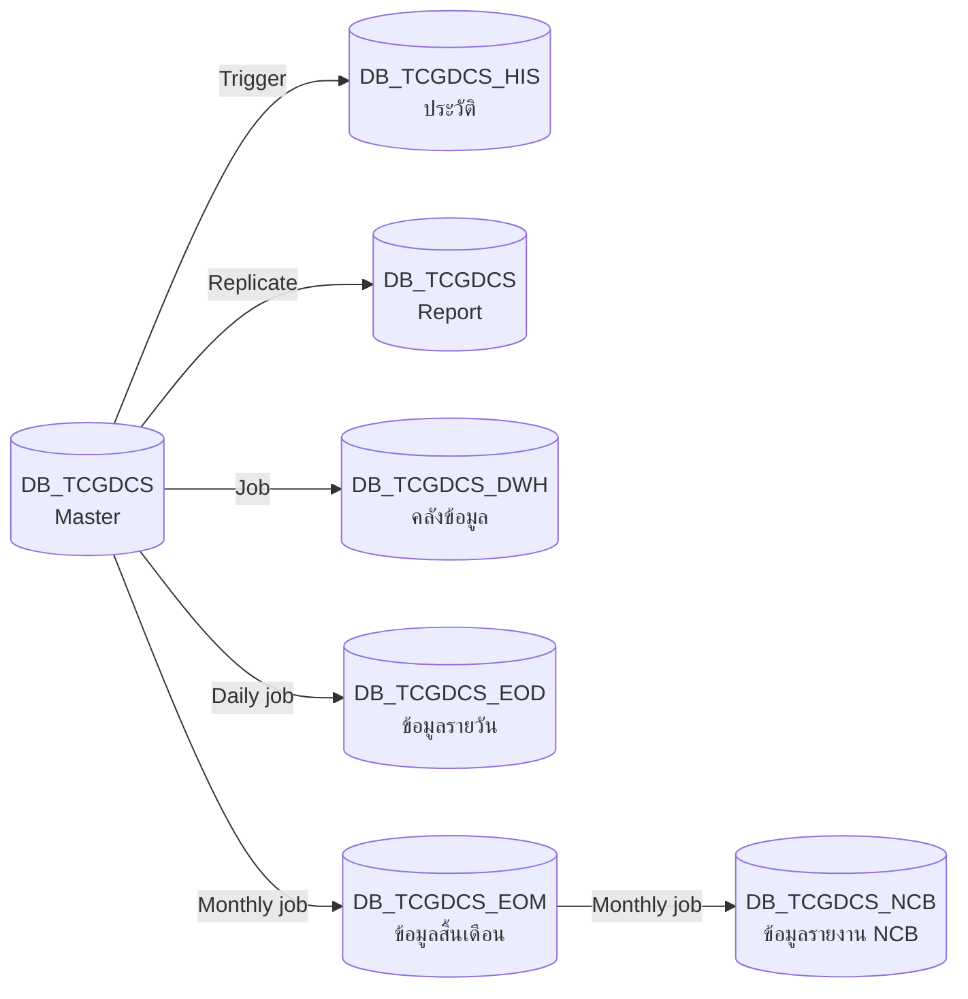
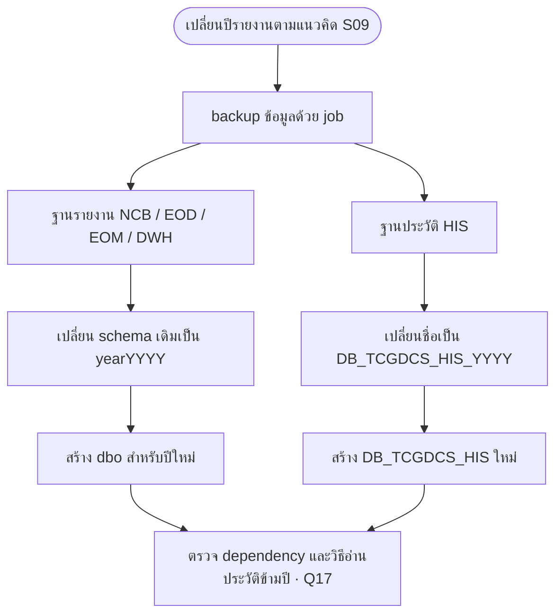
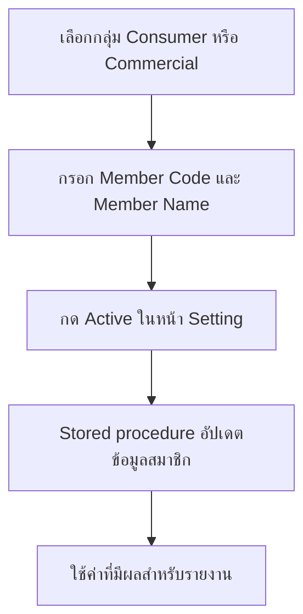

# ฐานข้อมูลและการเก็บประวัติ

S09 อธิบายแนวคิดแยกฐานข้อมูลระบบหลัก ข้อมูลรายงาน และประวัติ ยังไม่มี DDL หรือรายการ job ให้ตรวจว่าสร้างใช้งานจริงแล้ว

## ฐานข้อมูลตามเอกสาร

| ฐานข้อมูล | หน้าที่ที่ระบุ |
| --- | --- |
| DB_TCGDCS | ฐานข้อมูลหลัก Master |
| DB_TCGDCS (Report) | ฐานข้อมูลสำหรับรายงาน แยกบทบาทจาก Master ตามภาพ S09 |
| DB_TCGDCS_NCB | ข้อมูลรายงาน NCB ปีปัจจุบัน |
| DB_TCGDCS_EOD | ข้อมูลรายวันปีปัจจุบัน |
| DB_TCGDCS_EOM | ข้อมูลสิ้นเดือนปีปัจจุบัน |
| DB_TCGDCS_DWH | ข้อมูล Data Warehouse ปีปัจจุบัน |
| DB_TCGDCS_HIS | ประวัติที่แยกจากระบบหลัก |

## การเชื่อมข้อมูลระหว่างฐานข้อมูล

ภาพใน **NCB Note (S09)** แสดงให้ `DB_TCGDCS (Master)` เป็นแหล่งข้อมูลหลัก แล้วแยกส่งข้อมูลไปยังฐานประวัติ ฐานรายงาน คลังข้อมูล และฐานข้อมูลรายวัน/สิ้นเดือน โดยข้อมูล NCB รับต่อจากฐาน EOM ผ่านงานรายเดือน

ลูกศรแสดงทิศทางการส่งข้อมูลตามภาพต้นทาง ส่วนชื่อบนลูกศรระบุกลไกหรือรอบการทำงาน ไม่ได้ระบุเวลารันหรือลำดับการทำงานของทุก job

| เส้นทางข้อมูล | กลไก / รอบงานตามภาพ | ความหมาย |
| --- | --- | --- |
| Master → HIS | Trigger | ใช้ trigger ส่งข้อมูลจากฐานหลักไปยังฐานประวัติ โดยภาพไม่ได้ระบุตารางหรือเหตุการณ์ที่กระตุ้น |
| Master → Report | Replicate | ทำสำเนาข้อมูลจากฐานหลักไปยังฐานสำหรับรายงาน โดยภาพไม่ได้ระบุรูปแบบ replication หรือระยะเวลาหน่วง |
| Master → DWH | Job | ใช้งานประมวลผลส่งข้อมูลเข้าคลังข้อมูล โดยภาพไม่ได้ระบุรอบเวลา |
| Master → EOD | Daily job | งานรายวันนำข้อมูลจากฐานหลักไปยังฐาน EOD (End of Day) |
| Master → EOM | Monthly job | งานรายเดือนนำข้อมูลจากฐานหลักไปยังฐาน EOM (End of Month) |
| EOM → NCB | Monthly job | งานรายเดือนนำข้อมูลสิ้นเดือนไปยังฐาน NCB เพื่อใช้จัดทำข้อมูลรายงานเครดิต |

`DB_TCGDCS (Master)` และ `DB_TCGDCS (Report)` เป็นชื่อที่แสดงในภาพเพื่อแยกบทบาทของฐานข้อมูล ต้องยืนยันชื่อ instance/server และชื่อฐานข้อมูลที่ใช้งานจริงเพิ่มเติม ภาพนี้ยังไม่ได้ระบุรายละเอียดการแปลงข้อมูล เงื่อนไขคัดเลือก การจัดการข้อผิดพลาด หรือวิธีรันซ้ำ

ผังแสดงเส้นทาง **Master → EOM → NCB** โดยตรง จึงไม่ควรตีความว่าข้อมูลต้องผ่าน EOD หรือ DWH ก่อนเข้า EOM/NCB ดู [ขั้นตอนการประมวลผลข้อมูล](/data-flow) สำหรับภาพรวมการเตรียมข้อมูลรายงาน

## การเปลี่ยนปี

เอกสารเสนอให้จัดการด้วย job โดยฐานรายงานเปลี่ยน schema ปีปัจจุบันเป็น `year2026` ตามตัวอย่าง และสร้าง `dbo` สำหรับปีใหม่ ส่วนฐาน HIS เปลี่ยนชื่อเป็น `DB_TCGDCS_HIS_2026` แล้วสร้าง `DB_TCGDCS_HIS` ใหม่

นี่เป็นแนวคิดในเอกสาร ไม่ใช่ runbook ที่พร้อมดำเนินการ ต้องระบุ dependency ของ view, stored procedure, permission, synonym และการ query ข้ามปีก่อนใช้งานจริง

YYYY ในผังคือปีของข้อมูลเดิมที่เก็บประวัติ ขั้นตอนตรวจ dependency เป็นประเด็นที่ต้องยืนยันก่อนจัดทำ runbook จริง

## Member Master

S07 ระบุ `NCBMemberMaster` มีข้อมูลดังนี้

| คอลัมน์ | รายละเอียด |
| --- | --- |
| NCBMemberId | int |
| MemberCode | nvarchar แยกค่าตาม environment |
| MemberName | nvarchar |
| ReportType | 1 = Consumer, 2 = Commercial |
| Description | คำอธิบาย |
| IsActive | True/False |

ขั้นตอนในเอกสารคือกรอก Member Code และ Member Name ทาง frontend แล้วกด active เพื่อให้ stored procedure อัปเดตค่า ทั้งนี้ยังไม่ระบุชื่อ procedure การป้องกัน active ซ้ำ หรือวันมีผลของ configuration

ต้องยืนยัน environment, วันมีผล และการป้องกัน active ซ้ำตาม Q16 ก่อนใช้ขั้นตอนนี้เป็นข้อกำหนดหน้าจอ

## Registration Master

`NCBRegistrationMaster` ใช้แปลงประเภทนิติบุคคลจาก Thai Prefix/TitleId เป็น RegistrationType เช่น บจก. เป็น 1140001 และ หจก. เป็น 1140002 รหัส 1140005 ถูกใช้กับหลายประเภท เช่น หสม. กิจการร่วมค้า โรงเรียน และมหาวิทยาลัย จึงไม่ควรใช้ RegistrationType เป็นคีย์ unique ของรายการประเภทโดยไม่มีข้อกำหนดเพิ่มเติม

## ข้อเสนอแนะด้านการตรวจสอบย้อนหลัง

ควรเก็บงวด แหล่ง snapshot เวอร์ชันกฎ เหตุผลการคัดออก และค่าที่ส่งจริง เพื่อเทียบสถานะ 21 และการนับ DPD ข้ามงวด รวมถึงแยกเวลา rerun จากวันที่ข้อมูลมีผล เอกสารต้นทางยังไม่กำหนด schema สำหรับ audit ดังกล่าว

**แหล่งอ้างอิง:** S07 และ S09 ดู [ทะเบียนเอกสาร](/sources)
