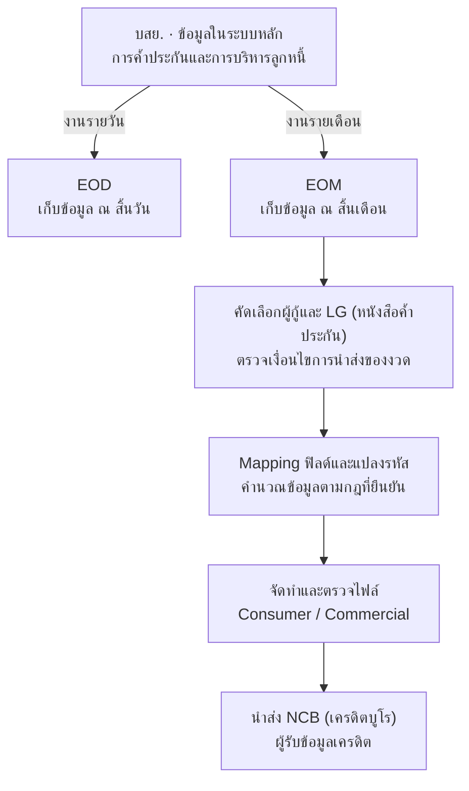
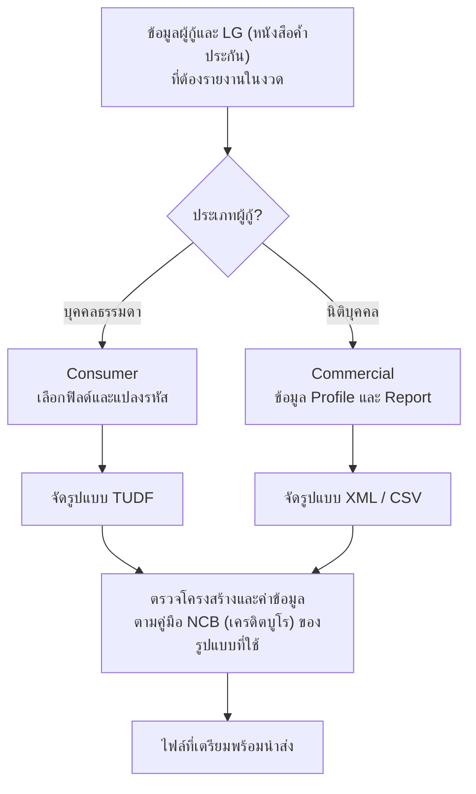
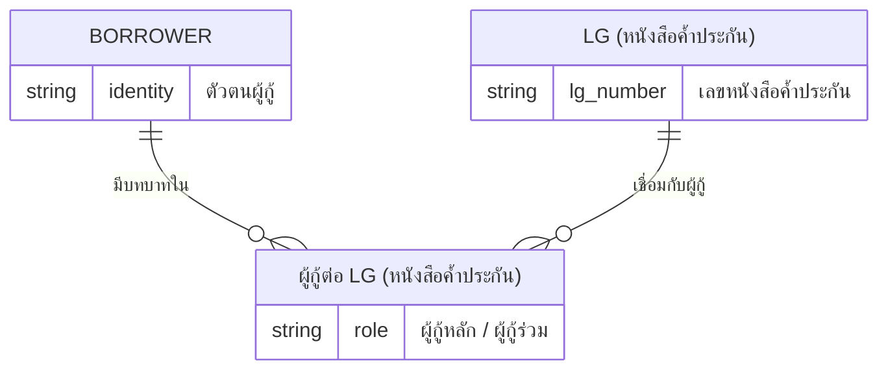
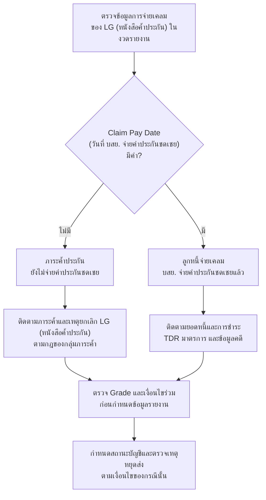

# ภาพรวม บสย. และการนำส่ง NCB (เครดิตบูโร)

โครงการจัดทำข้อมูลเครดิตของ บสย. เพื่อนำส่ง NCB (เครดิตบูโร) โดยนำข้อมูลการค้ำประกันและการบริหารลูกหนี้มาแปลงเป็นข้อมูลบ่งชี้ตัวตนและข้อมูลเครดิตตามประเภทผู้กู้

<a id="eod-eom-ncb-และ-บสย-คืออะไร" />

<a id="eod-eom-ncb-เครดิตบูโร-และ-บสย-คืออะไร" />

## บสย., NCB (เครดิตบูโร), EOD และ EOM คืออะไร

| คำ | ความหมาย | บทบาทในโครงการ |
| --- | --- | --- |
| บสย. · TCG | บรรษัทประกันสินเชื่ออุตสาหกรรมขนาดย่อม | หน่วยงานค้ำประกันสินเชื่อให้ผู้ประกอบการ SMEs และเป็นหน่วยงานที่จัดทำข้อมูลนำส่งในโครงการนี้ |
| NCB (เครดิตบูโร) · National Credit Bureau | บริษัท ข้อมูลเครดิตแห่งชาติ จำกัด หรือเครดิตบูโร | ผู้รับข้อมูลเครดิตจากสมาชิก; ในโครงการคำว่า “รายงาน NCB (เครดิตบูโร)” หมายถึงข้อมูลที่จัดเตรียมเพื่อนำส่ง |
| EOD · End of Day | ข้อมูล ณ สิ้นวัน หรือการประมวลผลปิดวัน | เก็บภาพข้อมูลรายวัน เช่น ยอดหนี้ การชำระ และจำนวนวันค้าง |
| EOM · End of Month | ข้อมูล ณ สิ้นเดือน หรือการประมวลผลปิดเดือน | ใช้ภาพข้อมูลของงวดเดือนเป็นแหล่งจัดทำรายงานตาม Mapping EOM |
| TDR · Troubled Debt Restructuring | การปรับปรุงโครงสร้างหนี้ที่มีปัญหา โดยตกลงปรับเงื่อนไขการชำระหนี้ให้เหมาะกับความสามารถของลูกหนี้ | ใช้ TDR Date และ TDR Code ประกอบการคำนวณ DFD, DPD, ยอดค้าง และสถานะบัญชีตามกฎของโครงการ |

จำง่าย ๆ: **บสย. = ผู้ค้ำประกันและผู้จัดทำข้อมูล, NCB (เครดิตบูโร) = ศูนย์รวมประวัติเครดิตจากสมาชิก, EOD = ข้อมูลสิ้นวัน, EOM = ข้อมูลสิ้นเดือน** โดย EOM ไม่ใช่การบวกยอดคงเหลือของ EOD ทุกวันเข้าด้วยกัน

บสย. และสมาชิกอื่นส่งข้อมูลให้ **NCB (เครดิตบูโร) รวบรวมเป็นข้อมูลเครดิต** เพื่อให้สถาบันการเงินใช้ประกอบการพิจารณาสินเชื่อร่วมกับข้อมูลด้านอื่น ๆ ชื่อเต็มของคำย่อคือ **National Credit Bureau** และชื่อหน่วยงานคือ **บริษัท ข้อมูลเครดิตแห่งชาติ จำกัด**

อ่าน [คำอธิบายพร้อมตัวอย่าง](/glossary) และ [แหล่งอ้างอิงความหมายของหน่วยงาน](/sources) เพิ่มเติม

<a id="why-tcg-reports-ncb" />

<a id="ทำไม-บสย-ต้องนำส่งข้อมูลไปยัง-ncb" />

## ทำไม บสย. ต้องนำส่งข้อมูลไปยัง NCB (เครดิตบูโร)

บสย. เป็นสมาชิก NCB (เครดิตบูโร) และมีข้อมูลภาระค้ำประกันกับข้อมูลลูกหนี้ในส่วนของตนเองที่ต้องรายงานตามหลักเกณฑ์ของสมาชิก

ในขอบเขตโครงการนี้ ธนาคารและ บสย. มีข้อมูลคนละส่วนที่เกี่ยวข้องกับผู้กู้รายเดียวกัน ดังนี้

| ผู้รายงาน | ความสัมพันธ์กับผู้กู้ | ข้อมูลที่เกี่ยวข้อง |
| --- | --- | --- |
| ธนาคาร | ผู้ให้สินเชื่อ | บัญชีสินเชื่อ ยอดหนี้ และประวัติการชำระต่อธนาคาร |
| บสย. ก่อนจ่ายเคลม | ผู้ค้ำประกัน | ภาระตาม LG (หนังสือค้ำประกัน) และสถานะของรายการค้ำประกันตามเงื่อนไข |
| บสย. หลังจ่ายเคลม | ผู้ติดตามลูกหนี้ที่เกิดจากการจ่ายค่าประกันชดเชย | ยอดหนี้และการชำระต่อ บสย. การปรับโครงสร้างหนี้ ข้อมูลคดี และการปิดบัญชีตามกฎ |

ตัวอย่างเชิงแนวคิด: ผู้ประกอบการกู้จากธนาคารโดยมี บสย. ค้ำประกัน เมื่อ บสย. จ่ายค่าประกันชดเชยให้ธนาคารตามเงื่อนไข จะมีข้อมูลลูกหนี้ต่อ บสย. ที่ต้องติดตามต่อ หากลูกหนี้ชำระ ทำ TDR หรือปิดบัญชี ข้อมูลที่ บสย. นำส่งต้องสะท้อนเหตุการณ์เหล่านี้ตามกฎของกรณีนั้น จึงต้องใช้ข้อมูลจาก บสย. ประกอบกับข้อมูลสินเชื่อจากธนาคารด้วย

ข้อมูลเครดิตช่วยให้สถาบันการเงินประเมินภาระและพฤติกรรมการชำระของผู้ขอสินเชื่อประกอบปัจจัยอื่น ๆ และช่วยสะท้อนประวัติการชำระที่ดีของเจ้าของข้อมูลด้วย ([SET: ประโยชน์ของข้อมูลเครดิต](https://elearning.set.or.th/SETGroup/glossary/credit-bureau?lang=en))

ตารางและตัวอย่างข้างต้นสรุปบทบาทในโครงการจาก S05/S11 ส่วนเงื่อนไขเลือกรายการ สถานะ และงวดสุดท้ายก่อนหยุดส่ง ดู [ภาพรวมการนำส่ง](/credit-reporting) และ [สถานะบัญชีและเงื่อนไขหยุดนำส่ง](/account-status)

## ภาพรวมการจัดทำรายงาน

ผังนี้สรุปบทบาทของระบบหลัก ข้อมูลรายวัน ข้อมูลสิ้นเดือน และการเตรียมรายงานของ บสย. เพื่อให้เห็นภาพก่อนอ่านรายละเอียดแต่ละหมวด

EOD และ EOM แยกรับข้อมูลจากระบบหลักตามภาพ S09 ลูกศรไม่ได้กำหนดให้รัน EOD ต่อเป็น EOM และขั้นเตรียมรายงานเป็นภาพสังเคราะห์เพื่ออธิบายงาน ยังไม่ได้ระบุชื่อ job หรือเวลา cutoff ดู [ผังเชื่อมฐานข้อมูล](/database#การเชื่อมข้อมูลระหว่างฐานข้อมูล) และ [กระบวนการข้อมูล](/data-flow) สำหรับรายละเอียด

## กลุ่มรายงาน

| กลุ่ม | เจ้าของข้อมูล | ชุดข้อมูลและรูปแบบตามเอกสาร |
| --- | --- | --- |
| Consumer | บุคคลธรรมดา รวมถึงชาวต่างชาติที่ใช้เอกสารระบุตัวตนตามเงื่อนไข | ข้อมูลบุคคลและบัญชี รูปแบบ TUDF |
| Commercial | นิติบุคคล เช่น บริษัท ห้างหุ้นส่วน และนิติบุคคลอื่นตามเอกสารจัดตั้ง | Commercial Profile และ Commercial Report รูปแบบ XML และ CSV |

ตัวรายงานภายในกับไฟล์ส่งออกเป็นคนละชั้นของข้อมูล ชื่อคอลัมน์ในเอกสาร Mapping ไม่ได้ยืนยันตำแหน่ง ความยาว หรือ encoding ของไฟล์ TUDF/XML/CSV ครบทุกฟิลด์

ผังใช้ประเภทผู้กู้แยกชุดรายงานตาม S02 การตรวจรูปแบบต้องใช้คู่มือสำหรับไฟล์จริงประกอบ จึงยังไม่สรุปว่าตาราง Mapping เพียงอย่างเดียวเพียงพอสำหรับสร้างไฟล์นำส่ง

### TUDF คืออะไร

**TUDF ย่อมาจาก TransUnion Data Format** เป็นรูปแบบจัดข้อมูลสำหรับนำส่งข้อมูลเครดิตให้เครดิตบูโร ในเอกสารโครงการนี้ใช้กับ **Consumer หรือข้อมูลบุคคลธรรมดาที่ บสย. เตรียมนำส่ง NCB (เครดิตบูโร)**

ไฟล์นำส่งต้องจัดข้อมูลตามข้อกำหนดของรูปแบบ เช่น ข้อมูลระบุตัวตน ที่อยู่ เลขบัญชีหรือ LG (หนังสือค้ำประกัน) ยอดหนี้ สถานะบัญชี และประวัติการชำระ จึงต้องแปลงข้อมูลจากตารางรายงานภายในให้เป็นรูปแบบนำส่งก่อน

ตัวอย่างเชิงแนวคิด: ระบบมีข้อมูลผู้กู้และ LG (หนังสือค้ำประกัน) ใน EOM → เลือกฟิลด์ที่ต้องรายงานและแปลงรหัส → จัดเป็นไฟล์ Consumer รูปแบบ TUDF ตามคู่มือ NCB (เครดิตบูโร) → ตรวจความถูกต้องก่อนนำส่ง ขั้นตอนนี้ต่างจากการส่งออกตารางเป็น Excel หรือ CSV โดยตรง

**รายละเอียดที่ต้องใช้คู่มือ NCB (เครดิตบูโร) ยืนยัน:** รุ่น format, โครงสร้างแต่ละส่วน, ลำดับและความยาวฟิลด์, encoding, รูปแบบวันที่ และค่าที่ใช้แทนข้อมูลว่าง เอกสารในโฟลเดอร์ยังไม่ได้ให้สเปกสร้างไฟล์ครบทั้งหมด และไม่ควรนำสเปก TUDF ของประเทศอื่นมาใช้แทนโดยอัตโนมัติ

การใช้ TUDF สำหรับ Consumer อ้างอิง S02 ส่วนชื่อเต็มคำย่อดู [แหล่งอ้างอิงเพิ่มเติม](/sources)

### TDR คืออะไร

**TDR ย่อมาจาก Troubled Debt Restructuring** หมายถึง **การปรับปรุงโครงสร้างหนี้ที่มีปัญหา** โดยเจ้าหนี้และลูกหนี้ตกลงปรับเงื่อนไขการชำระ เช่น จำนวนเงินที่ชำระในแต่ละงวด อัตราดอกเบี้ย หรือระยะเวลาชำระ เพื่อให้สอดคล้องกับความสามารถในการชำระหนี้ของลูกหนี้ TDR ไม่ได้หมายถึงการยกหนี้ และไม่เหมือนกับการพักชำระหนี้ทุกกรณี

ในโครงการนี้ เมื่อมีแผน TDR ระบบต้องพิจารณา `TDR Date` (วันที่ทำหรือเริ่มแผนปรับโครงสร้างหนี้) และ `TDR Code` (รหัสประเภทการปรับโครงสร้างหนี้) ร่วมกับ DFD, DPD, ยอดค้าง และสถานะบัญชี ในเดือนที่เข้าเงื่อนไข Set Zero เอกสารระบุให้เคลียร์ค่าค้างบางรายการตามกฎ แต่ไม่ได้หมายความว่าบัญชีที่ทำ TDR ทุกบัญชีมี DPD เป็นศูนย์ตลอดไป ดู [กฎ DFD DPD และ TDR](/business-rules) และ [เงื่อนไขสถานะบัญชี](/account-status#eom-claimed-with-tdr)

<a id="หน่วยข้อมูล-lg-by-id" />

## หน่วยข้อมูล LG (หนังสือค้ำประกัน) by ID

นำส่งเฉพาะผู้กู้หลักและผู้กู้ร่วม ไม่รวมผู้ค้ำประกัน กรรมการ หรือผู้ถือหุ้นที่ไม่ได้อยู่ในบทบาทดังกล่าว

| ตัวอย่างสมมติ | ผู้กู้ | บทบาท |
| --- | --- | --- |
| LG-A (ตัวอย่างเลขหนังสือค้ำประกัน) | บุคคล ก | ผู้กู้หลัก |
| LG-A (ตัวอย่างเลขหนังสือค้ำประกัน) | บุคคล ข | ผู้กู้ร่วม |
| LG-B (ตัวอย่างเลขหนังสือค้ำประกัน) | บุคคล ก | ผู้กู้ร่วม |

ตัวอย่างนี้มี 3 รายการรายงาน หนึ่ง LG (หนังสือค้ำประกัน) มีหลายคนได้ และคนเดียวมีหลาย LG (หนังสือค้ำประกัน) ได้ จึงไม่ควรตัดรายการซ้ำด้วยเลข LG (หนังสือค้ำประกัน) เพียงอย่างเดียวหรือเลขประจำตัวเพียงอย่างเดียว

<a id="er-diagram-ความสัมพันธ์-lg-by-id" />

### ER Diagram ความสัมพันธ์ LG (หนังสือค้ำประกัน) by ID

**ผังเชิงแนวคิด:** `BORROWER` แทนผู้กู้ ส่วน `LG` (หนังสือค้ำประกัน) เชื่อมกับผู้กู้ผ่าน `LG_BORROWER` (รายการเชื่อมผู้กู้กับหนังสือค้ำประกัน) ซึ่งระบุบทบาท แต่ละรายการเชื่อมอ้างผู้กู้หนึ่งรายและ LG (หนังสือค้ำประกัน) หนึ่งฉบับ ทำให้แทนความสัมพันธ์ผู้กู้หลายรายกับ LG (หนังสือค้ำประกัน) หลายฉบับได้ เส้นปลายก้างปลา `0..หลาย` แสดงจำนวนรายการเชื่อมที่อาจมี ไม่ใช่จำนวนผู้กู้ขั้นต่ำของ LG (หนังสือค้ำประกัน) ที่ได้รับอนุมัติ

ชื่อ entity และชนิด `string` ใช้อธิบายความสัมพันธ์เท่านั้น ไม่ใช่ชื่อตารางหรือชนิดข้อมูลจริง ผังนี้ยังไม่กำหนด primary key, foreign key หรือ unique constraint และยังไม่ได้แสดงงวดรายงาน

**ข้อเสนอแนะสำหรับออกแบบ:** กำหนดคีย์รายงานให้ครอบคลุมงวด LG (หนังสือค้ำประกัน) ตัวตน และบทบาท พร้อมตรวจเงื่อนไขผู้กู้คนเดียวมีหลายบทบาทก่อนสร้าง unique constraint ทั้งนี้เอกสารยังไม่ได้ระบุ physical key ของตาราง

## กลุ่มภาระค้ำและกลุ่มลูกหนี้

ดู [Flowchart ภาพรวมการนำส่ง NCB (เครดิตบูโร)](/credit-reporting) เพื่อเทียบเส้นทางบัญชีธนาคาร ภาระค้ำประกัน และลูกหนี้จ่ายเคลม พร้อมคำอธิบายสถานะและเงื่อนไข

| กลุ่ม | คำอธิบายใน S05 | ผลต่อข้อมูล |
| --- | --- | --- |
| ภาระค้ำประกัน เกรด A–E2 | ยังไม่มีวันจ่ายเคลม | รายงานภาระค้ำและค่าตั้งต้นของข้อมูลหนี้ตามกฎ |
| ลูกหนี้จ่ายเคลม เกรด F | บสย. จ่ายค่าประกันชดเชยและเกิดลูกหนี้ต่อ บสย. | ใช้ยอดหนี้ การชำระ TDR และข้อมูลคดี |

S11 ระบุกลุ่มจ่ายเคลมครอบคลุม E1/E2/F ต่างจาก S05 ซึ่งสรุปเป็น F ต้องยืนยันว่าการแบ่งกลุ่มอิง Grade, Claim Pay Date (วันที่ บสย. จ่ายค่าประกันชดเชย) หรือทั้งสองอย่าง และให้กฎใดมีลำดับก่อน

ผังนี้อธิบายเหตุที่แยกภาระค้ำออกจากลูกหนี้จ่ายเคลม ต้องตรวจ Grade ร่วมกับวันจ่ายเคลมตาม Q02 ไม่ใช้วันจ่ายเคลมอย่างเดียวตัดสินสถานะบัญชี ดู [เงื่อนไข EOM ทั้ง 3 กลุ่ม](/account-status#eom-account-status) และ [ภาพรวมการนำส่ง](/credit-reporting) สำหรับรายละเอียด

## ผลลัพธ์ที่เอกสารครอบคลุม

- รายงาน Consumer และ Commercial พร้อมข้อมูลระบุตัวตนและข้อมูลเครดิต
- การ Mapping ฟิลด์ การแปลงรหัส และการกำหนดค่า default
- การกำหนดสถานะบัญชีจากหนี้ TDR มาตรการ และคดีความ
- เงื่อนไขหยุดนำส่งและบางกรณีที่ต้องกลับมาส่งสถานะปิดบัญชี
- แนวคิดแยกฐานข้อมูลรายงาน ประวัติ และการจัดเก็บข้อมูลข้ามปี

## หมวดเอกสาร

- [Flowchart ภาพรวมการนำส่ง NCB (เครดิตบูโร)](/credit-reporting): ธนาคาร ภาระค้ำประกัน A–E2 และลูกหนี้จ่ายเคลม F
- [Flowchart กระบวนการข้อมูล](/data-flow): ขั้นตอนสร้างรายงานและการเลือก Mapping
- [พจนานุกรมฟิลด์](/fields): Mapping เต็มตารางจากเอกสารทั้งสองแนวทาง
- [Flowchart กฎคำนวณ](/business-rules): เงื่อนไข DFD, DPD, TDR และ Amount Past Due
- [กรณีทดสอบและ UAT](/testing): ขอบเขตทดสอบและสถานะตามไฟล์ที่ได้รับ
- [ประเด็นที่ต้องยืนยัน](/open-questions): ข้อขัดแย้งและคำถามก่อนพัฒนา

## วิธีใช้เอกสาร

เริ่มจากบทบาท บสย. และเหตุผลที่นำส่ง NCB (เครดิตบูโร) ทำความเข้าใจข้อมูล EOD และ EOM จากนั้นอ่านกลุ่มรายงานและหน่วยข้อมูล LG (หนังสือค้ำประกัน) by ID ในหน้านี้ แล้วดู [กระบวนการข้อมูล](/data-flow) ก่อนเลือก Mapping ที่จะใช้จริง จากนั้นอ่าน [กฎธุรกิจ](/business-rules) คู่กับ [สถานะบัญชี](/account-status) และตรวจ [ประเด็นที่ต้องยืนยัน](/open-questions) ก่อนกำหนดผลทดสอบที่คาดหวัง

ตารางฟิลด์รักษาชื่อสะกดตามต้นฉบับเพื่อให้ตามกลับได้ การปรากฏชื่อฟิลด์ในตารางยังไม่ยืนยันว่ามีฟิลด์นั้นในฐานข้อมูลจริง เอกสารชุดนี้ไม่มี DDL, stored procedure หรือซอร์สโค้ดระบบให้ตรวจเทียบ

## สถานะของข้อมูลในเว็บ

ข้อมูลนี้เป็นสรุปข้อกำหนดในไฟล์ที่ได้รับ ไม่ใช่ผลตรวจระบบ production และไม่ได้ตรวจยืนยันประกาศภายนอกฉบับปัจจุบัน คำว่า “ปัจจุบัน” ในเอกสารต้นทางอ้างถึงช่วงเวลาที่เอกสารนั้นจัดทำ โปรดดู [ทะเบียนแหล่งอ้างอิง](/sources) และวันตัดข้อมูลของแต่ละแหล่ง

**แหล่งอ้างอิง:** S01, S02 และ S05–S11 ตามทะเบียนเอกสาร
