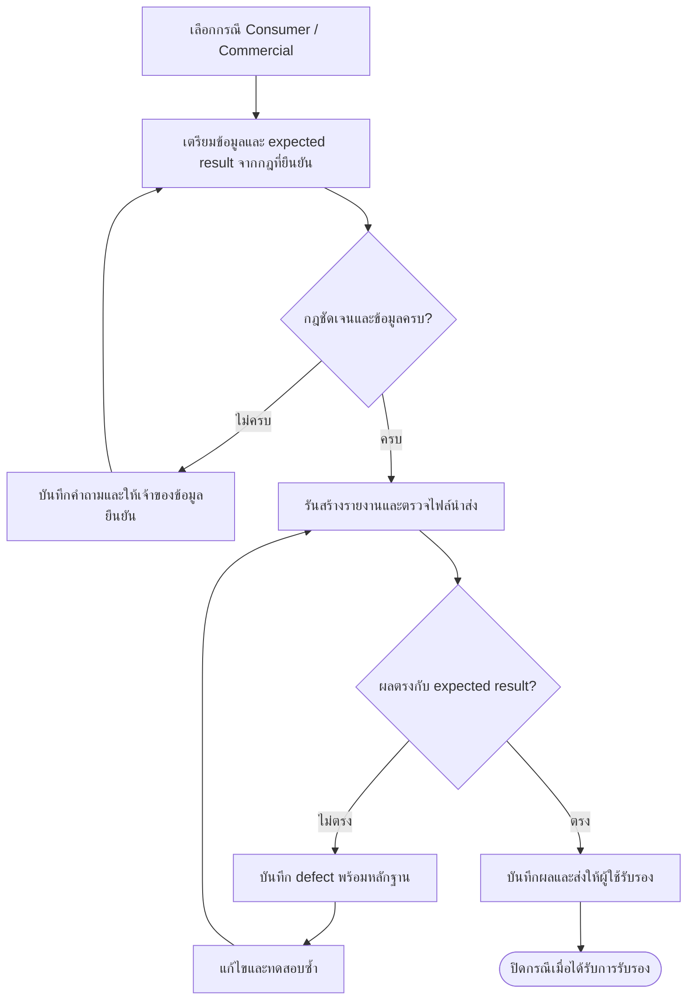

# กรณีทดสอบและ UAT

สรุปจาก `E2E_Test_Case_DCS_NCB.xlsx` (S01) ตามค่าที่บันทึกในไฟล์ที่ได้รับ ตัวเลขนี้ไม่ได้มาจากการรันทดสอบระบบใหม่

## โครงสร้างไฟล์ทดสอบ

| Sheet | เนื้อหา |
| --- | --- |
| Case | TestCaseID ชื่อกรณี สถานะบัญชี Sub Test สถานะงาน ช่วง Dev/Pre-UAT/UAT และหมายเหตุ |
| LG (หนังสือค้ำประกัน) | รายการทดสอบรายบัญชี การมีข้อมูลใน SIT/UAT สถานะตรวจ และหมายเหตุ |

## สถานะที่พบ

Sheet Case มี 46 แถวที่ระบุสถานะ `In-Progress` ในคอลัมน์ E และมี TestCaseID 18 แถวในช่วงข้อมูลก่อนตารางสรุป แถว Sub Test บางแถวไม่มี TestCaseID ใหม่ จึงไม่ควรเรียกทั้ง 46 แถวว่า 46 test cases ที่เป็นอิสระจากกัน

ใน Sheet LG (หนังสือค้ำประกัน) ช่วงแถว 3–61 และ 63–109 มีรายการที่คอลัมน์เลข LG (หนังสือค้ำประกัน) ไม่ว่าง 98 แถว ส่วนคอลัมน์ H ในช่วงแถวข้อมูลพบสถานะดังนี้

| สถานะตามไฟล์ | จำนวนแถว |
| --- | --- |
| Re Check With User | 73 |
| Failed | 12 |
| N/A | 9 |
| Passed | 3 |

จำนวนสถานะรวม 97 แถวไม่เท่ากับรายการเลข LG (หนังสือค้ำประกัน) 98 แถว จึงควรตรวจแถวที่ไม่มีสถานะก่อนสร้างอัตราผ่าน ไม่ใช้ตารางนี้สรุปว่าระบบผ่าน UAT แล้ว สูตรสรุปใน workbook ยังแยกนับเพียงบางชื่อสถานะ จึงควรตรวจชื่อสถานะให้ตรงกันก่อนใช้อัตราสรุป

## กลุ่มกรณีทดสอบ

| กลุ่ม | ตัวอย่างเงื่อนไข |
| --- | --- |
| ปกติ 10 | ทำ/ไม่ทำ TDR, TDR Code 00/02, ค้างไม่เกิน 90 วัน |
| ปิดบัญชี 11 | TDR ก่อน/ตั้งแต่ 1 เมษายน 2567 และการกลับมาส่งหลังหยุดนำส่ง |
| พักชำระ 12/13 | สถานะก่อนเข้ามาตรการและการมีแผน TDR |
| ค้าง 20/21 | DPD เกิน 90 วัน ประวัติสถานะ 21 และการเปลี่ยนสถานะ |
| คดี 30 | แพ่ง ล้มละลาย สวมสิทธิ์ ขอรับชำระหนี้ ถอนฟ้อง |
| คดี 31 | คำพิพากษาตามยอมร่วมกับ TDR |
| ตัดหนี้/โอน 33/42 | วันตัดหนี้สูญ วันปลดล้มละลาย และหยุดนำส่ง |

## ประเด็นจากหมายเหตุ

พบประเด็นเกี่ยวกับ DFD, TDR Date, สถานะ 21, การมีข้อมูลคดี และการมีแผน TDR สำหรับสถานะพักชำระ หมายเหตุอธิบายสาเหตุบางรายการ แต่ไม่ได้แทนการรับรองผลจากผู้ใช้ และไม่ควรถือว่าคำอธิบายใน remark มีลำดับเหนือกฎที่อนุมัติ

หน้าเว็บนี้ไม่เผยแพร่เลข LG (หนังสือค้ำประกัน) และข้อมูลตัวอย่างรายบัญชีจาก sheet LG (หนังสือค้ำประกัน)

## ชุดตรวจเพิ่มเติมที่เสนอ

### Flow การทดสอบและปิดประเด็นที่เสนอ

ผังนี้เป็นแนวทางดำเนินงานที่เสนอ ไม่ใช่สถานะทดสอบที่เกิดขึ้นแล้ว

1. ตัดงวดสิ้นเดือน รวมกุมภาพันธ์และปีอธิกสุรทิน
2. ทดสอบ DPD ที่ 0/1/30/31/60/61/90/91/300/301 วัน
3. เปลี่ยน TDR ก่อน/ตรง/หลัง 1 เมษายน 2567 และปิดบัญชีแต่ละกรณี
4. เข้า/ออกมาตรการ และยกเลิก TDR โดยตรวจ DPD ต่อเนื่อง
5. ใช้ LG (หนังสือค้ำประกัน) เดียวหลายผู้กู้ และผู้กู้เดียวหลาย LG (หนังสือค้ำประกัน)
6. ทดสอบคดี ถอนฟ้อง สวมสิทธิ์ และเหตุการณ์ซ้อนเพื่อยืนยัน priority
7. ทดสอบครบ 5 ปี 90 วันตรงสิ้นเดือน/ก่อนสิ้นเดือน และกลับมาส่งปิดบัญชี
8. ตรวจไฟล์นำส่งจริงทั้ง TUDF/XML/CSV รวมรหัส วันที่ encoding และ control totals

รายการนี้เป็นข้อเสนอ ไม่ใช่ผลทดสอบที่ดำเนินการแล้ว

**แหล่งอ้างอิง:** S01 — Case A1:N56; LG (หนังสือค้ำประกัน) A1:K125 และกฎจาก S05/S11 ดู [ทะเบียนเอกสาร](/sources)
